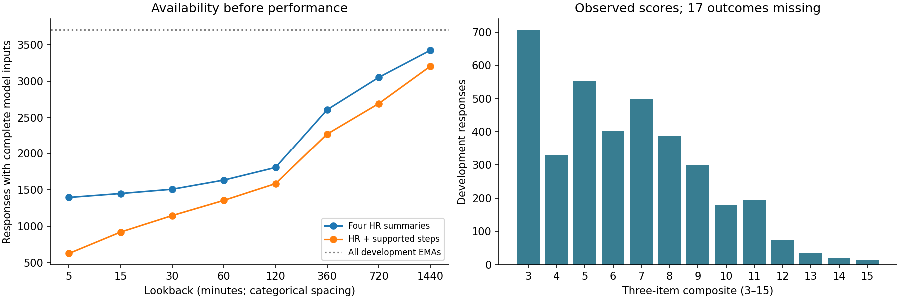
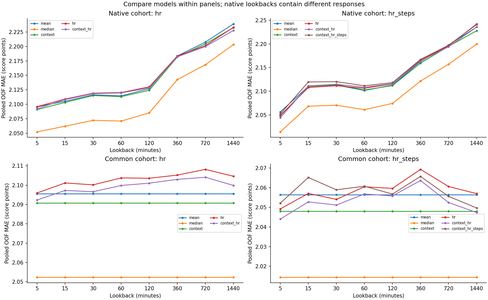
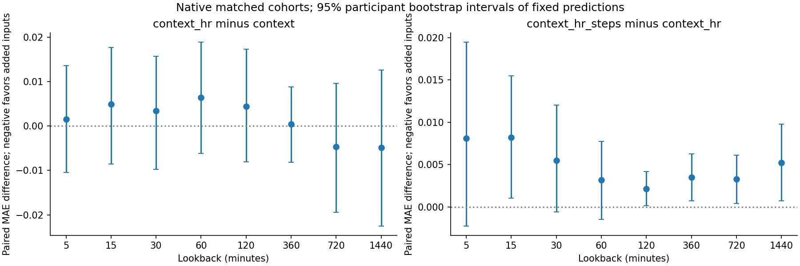
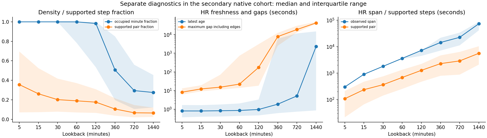

# Notebook 05 — exploratory EMA outcome linkage and HR/activity baseline

**These fixed, simple models show no useful incremental predictive gain from the tested wearable
summaries.** The training-median dummy has lower pooled MAE than every Ridge model in every native
and common comparison. Adding HR to context gives tiny, inconsistent changes; all eight primary
native intervals include zero. Adding supported steps increases native pooled MAE at every lookback.
This describes the specified models and available recordings, not absence of any physiological
relationship. No final lookback is selected.

All **3,706 development EMAs / 125 participants / five original folds** remain linked. All 32 final-test
participants remain sealed. Results are **exploratory prediction from recorded pre-EMA data, not
validated real-time prediction**: acquisition versus receipt/batching and counter semantics remain
provisional. No feature support threshold changed after viewing outcomes.

## What was scored and linked

The three raw export fields are `PSS_NERVOUS`, `PSS_COPE`, `PSS_CONTROL`. All three blank questionnaires
confirm stored codes 1–5 paired with display labels 0–4. Morning questionnaire names end in `_1`,
Endday in `_4`, and Midday has no suffix; the corrected raw exports use the unsuffixed fields in all
categories. `questionnaire_evidence.json` records item names, pages, option codes and document hashes.

For complete, valid integer-coded items only, score = nervous + (6−cope) + (6−control).
This is **the study's three-item perceived-stress composite**, range 3–15, not a full standardized PSS,
a diagnosis or a clinically validated cutoff. No binary targets were made. Morning asks since waking;
the other questionnaires refer to since the last prompt. Different reference periods limit a single
instantaneous-stress interpretation.

**3,689 scores are available; 17 responses remain missing.** The observed mean is 6.407, sample SD
2.696, median 6, range 3–15. All observed missing item cells are empty strings (47 cells across 17
responses); there are no nonmissing invalid codes. The PDFs do not define exporter missing sentinels.
The conservative token exclusions in the frozen specification are therefore assumptions, not claimed
survey documentation; they do not affect any observed nonblank value in this dataset.

| available | maximum | mean | median | minimum | missing | participants | responses | sd | survey_category |
| --- | --- | --- | --- | --- | --- | --- | --- | --- | --- |
| 3,689 | 15.000 | 6.407 | 6.000 | 3.000 | 17 | 125 | 3,706 | 2.696 | all |
| 932 | 15.000 | 6.281 | 6.000 | 3.000 | 2 | 124 | 934 | 2.673 | Endday |
| 1,826 | 15.000 | 6.344 | 6.000 | 3.000 | 12 | 125 | 1,838 | 2.692 | Midday |
| 931 | 15.000 | 6.656 | 7.000 | 3.000 | 3 | 125 | 934 | 2.712 | Morning |

Original item strings, parsed values, per-item statuses, outcome reason, source hash/row, actual local
start, stable EMA key and original folds remain in the ignored linked table. A one-to-one join checks
both key sets and participant/category/clock/fold agreement. Incomplete outcomes are retained but not
fit. The existing feature and separate quality tables are preserved byte-for-byte.

## The comparison fixed before fitting

[The frozen specification](../../ema_baseline_specification.md) fixes all models, cohorts, metrics
and bootstrap settings. Primary inputs are HR mean, sample SD, latest and slope. The secondary
block adds supported step additions. Context is survey category plus sine/cosine of actual local
start time, separate from wearable inputs. Floors, all other sensors, quality columns, identifiers
and current survey answers never enter the design matrix.

Within each block/lookback, mean and median dummies and all Ridge models train and validate on the
**same complete responses**. The secondary cohort refits the HR/context/dummy models on its smaller
matched cohort. Ridge alpha=1, with a training-only numerical scaler and category encoder, no tuning,
imputation, missingness predictors or prediction clipping. Participant folds are frozen; no person's
responses enter both sides of a fit. StandardScaler uses population variance; source HR SD uses N−1.

Native HR cohorts range from 1,395 responses / 117 participants at five minutes to 3,426 / 123 at
24 hours. Secondary cohorts range from 625 / 104 to 3,207 / 123. Common intersections across every
lookback retain **1,395 / 117 for HR** and **625 / 104 for HR+steps**. These exceed the prespecified
minimum descriptive-size flags, with 22–25 and 20–21 validation participants per fold respectively.
They are selected recording-available subsets, not representative samples. Common-cohort training
AND validation membership is held constant across lookbacks. All 160 fold/cohort fits were feasible.

## Matched performance

MAE is in composite-score points; lower is better. Each row is a matched comparison. Native rows at
different lookbacks contain different responses and must not be ranked as if they share a test set.
`mean`/`median` denote matching training-outcome dummies. The unchanged common-cohort dummy/context
values across lookbacks are an additional matching check.

### Native hr cohort: pooled MAE

| lookback_minutes | responses | participants | mean | median | context | hr | context_hr |
| --- | --- | --- | --- | --- | --- | --- | --- |
| 5 | 1,395 | 117 | 2.096 | 2.052 | 2.091 | 2.096 | 2.092 |
| 15 | 1,449 | 118 | 2.105 | 2.062 | 2.103 | 2.109 | 2.108 |
| 30 | 1,508 | 118 | 2.116 | 2.072 | 2.115 | 2.119 | 2.118 |
| 60 | 1,634 | 118 | 2.115 | 2.071 | 2.113 | 2.120 | 2.120 |
| 120 | 1,808 | 119 | 2.127 | 2.085 | 2.124 | 2.130 | 2.129 |
| 360 | 2,608 | 123 | 2.184 | 2.143 | 2.182 | 2.183 | 2.182 |
| 720 | 3,053 | 123 | 2.207 | 2.168 | 2.204 | 2.201 | 2.200 |
| 1,440 | 3,426 | 123 | 2.239 | 2.203 | 2.232 | 2.233 | 2.227 |
### Native hr_steps cohort: pooled MAE

| lookback_minutes | responses | participants | mean | median | context | hr | context_hr | context_hr_steps |
| --- | --- | --- | --- | --- | --- | --- | --- | --- |
| 5 | 625 | 104 | 2.056 | 2.014 | 2.048 | 2.049 | 2.044 | 2.052 |
| 15 | 919 | 111 | 2.110 | 2.069 | 2.110 | 2.108 | 2.111 | 2.120 |
| 30 | 1,146 | 113 | 2.113 | 2.071 | 2.114 | 2.112 | 2.115 | 2.120 |
| 60 | 1,355 | 113 | 2.102 | 2.061 | 2.103 | 2.106 | 2.108 | 2.112 |
| 120 | 1,585 | 118 | 2.113 | 2.074 | 2.112 | 2.116 | 2.116 | 2.118 |
| 360 | 2,272 | 123 | 2.163 | 2.121 | 2.159 | 2.166 | 2.164 | 2.167 |
| 720 | 2,693 | 123 | 2.198 | 2.157 | 2.195 | 2.196 | 2.194 | 2.197 |
| 1,440 | 3,207 | 123 | 2.236 | 2.200 | 2.228 | 2.242 | 2.236 | 2.241 |
### Common hr cohort: pooled MAE

| lookback_minutes | responses | participants | mean | median | context | hr | context_hr |
| --- | --- | --- | --- | --- | --- | --- | --- |
| 5 | 1,395 | 117 | 2.096 | 2.052 | 2.091 | 2.096 | 2.092 |
| 15 | 1,395 | 117 | 2.096 | 2.052 | 2.091 | 2.101 | 2.097 |
| 30 | 1,395 | 117 | 2.096 | 2.052 | 2.091 | 2.100 | 2.097 |
| 60 | 1,395 | 117 | 2.096 | 2.052 | 2.091 | 2.104 | 2.100 |
| 120 | 1,395 | 117 | 2.096 | 2.052 | 2.091 | 2.104 | 2.101 |
| 360 | 1,395 | 117 | 2.096 | 2.052 | 2.091 | 2.105 | 2.103 |
| 720 | 1,395 | 117 | 2.096 | 2.052 | 2.091 | 2.108 | 2.104 |
| 1,440 | 1,395 | 117 | 2.096 | 2.052 | 2.091 | 2.105 | 2.100 |
### Common hr_steps cohort: pooled MAE

| lookback_minutes | responses | participants | mean | median | context | hr | context_hr | context_hr_steps |
| --- | --- | --- | --- | --- | --- | --- | --- | --- |
| 5 | 625 | 104 | 2.056 | 2.014 | 2.048 | 2.049 | 2.044 | 2.052 |
| 15 | 625 | 104 | 2.056 | 2.014 | 2.048 | 2.057 | 2.053 | 2.065 |
| 30 | 625 | 104 | 2.056 | 2.014 | 2.048 | 2.054 | 2.051 | 2.059 |
| 60 | 625 | 104 | 2.056 | 2.014 | 2.048 | 2.060 | 2.057 | 2.061 |
| 120 | 625 | 104 | 2.056 | 2.014 | 2.048 | 2.060 | 2.056 | 2.057 |
| 360 | 625 | 104 | 2.056 | 2.014 | 2.048 | 2.069 | 2.064 | 2.066 |
| 720 | 625 | 104 | 2.056 | 2.014 | 2.048 | 2.061 | 2.052 | 2.056 |
| 1,440 | 625 | 104 | 2.056 | 2.014 | 2.048 | 2.057 | 2.047 | 2.050 |

`metrics.json` includes all pooled and fold-level **MAE, RMSE and equally weighted participant MAE**;
`fold_counts.json` supplies every training/validation response and participant count. At five minutes
on the primary cohort, context+HR MAE/RMSE/participant-MAE are **2.092 / 2.548 / 2.220**, versus the
matching median dummy **2.052 / 2.563 / 2.181**. This illustrates that optimizing mean-squared loss
can modestly improve RMSE while losing on the prespecified primary MAE. At 24 hours those primary
context+HR metrics are **2.227 / 2.695 / 2.236**, versus **2.203 / 2.721 / 2.208** for median.

## Paired uncertainty and wearable increment

Below are native pooled MAE differences: context+HR minus context in the HR block; context+HR+steps
minus context+HR in the secondary block. Negative favors the added inputs. The full
`paired_intervals.json` also compares every Ridge model to matching mean/median/context baselines,
and reports participant-averaged differences and intervals for both native and common cohorts.

| block | lookback_minutes | mae_difference | mae_difference_low | mae_difference_high |
| --- | --- | --- | --- | --- |
| hr | 5 | 0.002 | -0.010 | 0.014 |
| hr | 15 | 0.005 | -0.009 | 0.018 |
| hr | 30 | 0.003 | -0.010 | 0.016 |
| hr | 60 | 0.006 | -0.006 | 0.019 |
| hr | 120 | 0.004 | -0.008 | 0.017 |
| hr | 360 | 0.000 | -0.008 | 0.009 |
| hr | 720 | -0.005 | -0.019 | 0.010 |
| hr | 1,440 | -0.005 | -0.023 | 0.013 |
| hr_steps | 5 | 0.008 | -0.002 | 0.019 |
| hr_steps | 15 | 0.008 | 0.001 | 0.015 |
| hr_steps | 30 | 0.005 | -0.001 | 0.012 |
| hr_steps | 60 | 0.003 | -0.001 | 0.008 |
| hr_steps | 120 | 0.002 | 0.000 | 0.004 |
| hr_steps | 360 | 0.003 | 0.001 | 0.006 |
| hr_steps | 720 | 0.003 | 0.000 | 0.006 |
| hr_steps | 1,440 | 0.005 | 0.001 | 0.010 |

Each 95% percentile interval uses 2,000 paired participant-cluster resamples with a fixed seed. All
responses of a sampled participant move together. Predictions are fixed; models are not refit during
bootstrapping. These are conditional development-prediction intervals, not independent-response
uncertainty, external validity, causal effects, or multiplicity-adjusted significance. Some small step
loss intervals exclude zero, but the many correlated comparisons do not justify a selected winner.

## Availability, missingness and recording support

The available/unavailable comparison below is descriptive; it did not select rules. Counts before
outcome filtering differ from the model cohort counts. The complete table includes all eight
lookbacks and all three survey categories, valid/missing outcomes and score means/medians/SDs.
Participants can appear in both groups at different EMA times.

| block | lookback_minutes | availability | responses | valid_outcomes | pss_mean |
| --- | --- | --- | --- | --- | --- |
| hr | 5 | available | 1,403 | 1,395 | 6.328 |
| hr | 5 | unavailable | 2,303 | 2,294 | 6.455 |
| hr_steps | 5 | available | 629 | 625 | 6.334 |
| hr_steps | 5 | unavailable | 3,077 | 3,064 | 6.422 |
| hr | 1,440 | available | 3,439 | 3,426 | 6.412 |
| hr | 1,440 | unavailable | 267 | 263 | 6.346 |
| hr_steps | 1,440 | available | 3,219 | 3,207 | 6.427 |
| hr_steps | 1,440 | unavailable | 487 | 482 | 6.276 |

`recording_status.json` separates absent recordings from entirely rejected readings.
`quality_diagnostics.json` shows counts, density, freshness, span, internal/edge gaps and step support
for all EMAs and matching model cohorts. These columns are diagnostic only. The Notebook 04
feature-specific exclusion reasons remain available in its separate quality dataset.

In the five-minute secondary cohort, median HR count is 192, span 298 seconds, freshness 0.80 seconds,
and maximum gap including edges 8.16 seconds; median supported step duration is 107 seconds. At
24 hours median HR span is about 20.4 hours, yet only 27.5% of minute bins contain readings, median
freshness is 38.4 minutes and maximum gap including edges is 11.8 hours. Median supported step time
is just 93.2 minutes (6.47% of 24 hours). Large span therefore does not establish continuous coverage.

**Two HR observations do not establish representative window coverage.** The four-feature block
also requires slope's three readings and 60-second span; even that is only a numerical support rule.
A supported zero step increment is observed zero, whereas no supported increment remains missing.
Step sums are supported additions, not whole-window activity. No interpolation, gap filling or
quality-derived predictor was introduced. Overlapping EMA lookbacks are not independent recordings;
no window count is multiplied by its length to claim coverage.

## Clearly synthetic teaching example

Imagine a second-resolution actual EMA start at 12:00, with a five-minute interval [11:55,12:00).
Synthetic HR values 60,90,120 at 11:55,11:56,11:57 give mean 90, sample SD 30, latest 120 and slope
30 bpm/min. A synthetic supported step pair 100→110 wholly inside that window contributes 10.
Synthetic answers nervous=4, cope=4, control=2 yield 4+2+4=10. The stable EMA key links that outcome
and its prior measurements. If the person's frozen fold is held out, all their records are excluded
from scaler/encoder/model fitting. A **hypothetical** held-out prediction of 7.5 has absolute error
2.5; it is not a real result or a calculated fit to this teaching row. A minute-resolution 12:00
start instead has cutoff 11:59. Neither changing the cutoff nor using the current answers as inputs
is allowed. Missing cope would leave the outcome missing and this response out of fitting.

## Interpretation and next experiment

The numerical pipeline is verified, but physiological/timing validity remains unresolved. More
available long-window data does not establish better measurement or a better prediction horizon.
Complete-case selection, repeated observations, changed native cohorts, unequal survey reference
periods and possible informative missingness limit generalization. Frozen grouped folds estimate
transfer to held-out development participants, not forecasting a participant's future responses.
Ridge is deliberately simple and these features may miss nonlinear or within-person relationships;
this checkpoint provides no authorization or evidence to pursue a more complex model as a remedy.

**Recommended next experiment:** after provider clarification of HR timestamp/batching and step
counter attribution, preregister a measurement-support sensitivity analysis on development data:
compare the same fixed models and matched cohorts under externally justified HR density/gap support
conditions. Select those conditions from device semantics before viewing score associations; retain
the current benchmark as the reference. The current tiny, inconsistent increments do not justify
expanded HRV, a chosen lookback, or final-test evaluation. The provider-question draft remains unsent.

## Outputs and verification

- Linked rows: `private/ema_baseline/runs/640600af77404ff6/linked_development.parquet` (3,706).
- Fixed OOF predictions: `private/ema_baseline/runs/640600af77404ff6/out_of_fold_predictions.parquet` (46,843 cohort/EMA rows,
  each carrying matched model predictions; repeated comparison views are not distinct EMAs).
- Complete inclusion flags: `private/ema_baseline/runs/640600af77404ff6/cohort_membership.parquet` (118,592 rows).
- Private fitted transform audit: `training_audit.json` in that bundle; no serialized executable models.
- Original separate quality: `private/hr_activity/features/76f5885b3955d5b0/quality.parquet`.
- Notebook: `notebooks/05_ema_outcome_baseline.ipynb`. Source output cells stay empty.
- Aggregate JSON tables, four figures and this report: `reports/ema_baseline/d933d3999d949477`.

All prior bundles, assignments and corrected supersession provenance are preserved. Independent
scalar arithmetic verifies every score; independent centered normal equations reproduce all 880
model fits within 9×10⁻¹⁴ score points. Tests, execution, privacy and input-integrity checks are
recorded in the separate checkpoint verification report. No final-test outcomes/sensors, expanded
HRV, binary targets, tuning, imputation, feature selection, commit or push.
