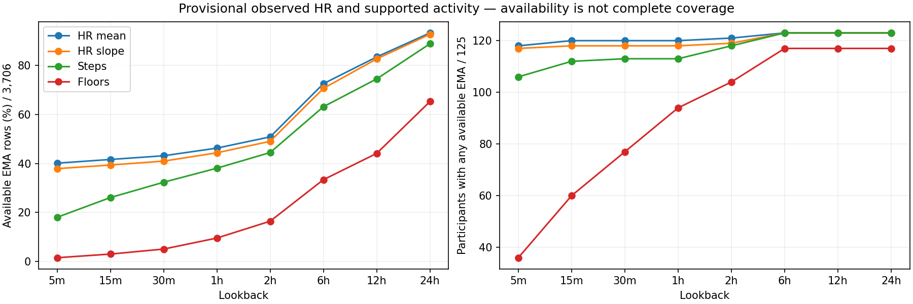
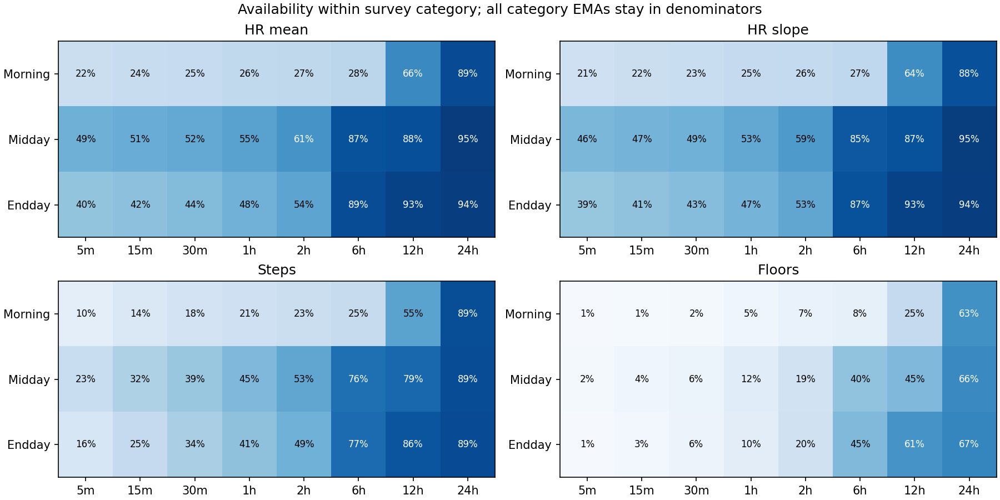
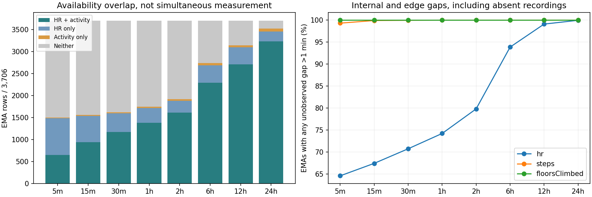

# Notebook 04 — corrected IBI audit and provisional HR/activity features

All **3,706 development EMAs, 125 participants and five frozen folds** are retained. All 32 final-test
participants remain sealed. This checkpoint reissues the faulty window audit and adds observed HR
summaries plus supported steps/floor increments. No expanded HRV, Garmin stress predictor, PSS target,
imputation, lookback/feature selection or model was calculated. Timing remains provisional because
acquisition versus receipt/batching semantics are unresolved.

## Corrected window provenance

The signed int16 minute-step multiplication wrapped at step 547 (9 h 7 min) and again at 1093.
We reissued all three frozen policies, both interval hypotheses, every approved lookback and all
survey categories using the fixed int64 generator. **3,294,634** of
**5,321,816** locations change; all thresholds are unchanged. Each window was
independently verified with Python integer/datetime arithmetic: exact 300-second duration,
60-second steps, membership wholly inside its lookback and no end beyond the actual EMA cutoff.
Regression cases include steps 546/547, 1092/1093 and 1435, the full 24-hour boundary.

Every approved result through six hours agrees with the obsolete version, including all
**1,319,336** corresponding diagnostic rows and all
coverage/attrition aggregates. The 12/24-hour changes below demonstrate why merely checking row
counts or regenerating offsets with the same dtype was insufficient.

| policy | hypothesis | minutes | old_windows | new_windows | old_EMAs | new_EMAs | new_participants |
| --- | --- | --- | --- | --- | --- | --- | --- |
| conservative | interval_end | 720 | 2 | 2 | 1 | 1 | 1 |
| conservative | interval_end | 1,440 | 6 | 6 | 3 | 3 | 1 |
| conservative | interval_start | 720 | 0 | 0 | 0 | 0 | 0 |
| conservative | interval_start | 1,440 | 0 | 0 | 0 | 0 | 0 |
| screen | interval_end | 720 | 9,020 | 9,096 | 918 | 813 | 103 |
| screen | interval_end | 1,440 | 18,964 | 18,907 | 1,323 | 1,350 | 104 |
| screen | interval_start | 720 | 6,926 | 7,016 | 779 | 693 | 97 |
| screen | interval_start | 1,440 | 14,681 | 14,647 | 1,152 | 1,192 | 98 |
| timing_sensitivity | interval_end | 720 | 28,265 | 28,126 | 1,555 | 1,375 | 117 |
| timing_sensitivity | interval_end | 1,440 | 59,707 | 57,478 | 2,082 | 2,104 | 117 |
| timing_sensitivity | interval_start | 720 | 28,079 | 27,979 | 1,567 | 1,378 | 116 |
| timing_sensitivity | interval_start | 1,440 | 59,300 | 57,224 | 2,089 | 2,122 | 116 |

The complete 192-row coverage table, all rejection reasons, unique-time unions and category results
are in the [corrected eligibility report](../../ibi_eligibility/974e98729579967b_8ac2c64795c6/report.md).
[The explicit supersession record](../../window_supersession.json) preserves old/new/delta counts,
supported-time changes and the affected artifact graph. Old bundles remain byte-identical.
Default bundle validation and both window loaders reject revoked versions even when renamed.
Historical checksum verification is explicitly separate and cannot authorize their use as inputs.

Notebook 02's dependent index and full continuity report were also reissued at
`private/hrv_input_validation/diagnostics/55eb9ba094e893b7` and
`reports/hrv_input_validation/d0e494f0d2cbeb42`. Its immediate rejection analyses,
synthetic calculations and whole-stream timing diagnostics are unchanged. Notebook 03's corrected
Screen index and limited pilot remain valid and unchanged. Inventory direct-lookback counts,
raw normalization, mappings, assignments and policies were not affected by the overflow.

## How one EMA becomes one feature row

Read only EMA identity/category/clock metadata. Recover the verified participant's authorized HR
and counter partitions. Derive actual UTC from local start minus its own offset; subtract 60 seconds
only for minute-resolution starts. Query [cutoff−lookback,cutoff) separately for all eight lookbacks.
Keep missing results in the original EMA row; retain its original fold. The private feature table
has **3,706 rows, 104 measurement columns**, of which **88** are explicitly listed as provisional
predictors. The 16 calorie/intensity placeholders stay missing and excluded. Identity, category,
cutoff, fold and quality are not predictors. No PSS outcome is attached.

[The prespecified feature specification](../../hr_activity_feature_specification.md) documents
source fields, units, sampling, duplicates and thresholds before feature retention was compared.
The [machine-readable dictionary](feature_dictionary.json) specifies every column, units, lookback,
minimum support and predictor role. Source strings and physical records stay in the unchanged
normalized bundle; the new reading ledger accounts for **17,364,780**
logical observations with dispositions and source-row/hash links.

## Definitions and exclusions

HR values are provisionally bpm. Accept finite 30–240 inclusive values with no existing clock
flags. Collapse a same-timestamp/same-value group to one analysis reading only if all members
pass; preserve original rows and reject conflicting groups. Identical values at different times
remain separate readings. These range/duplicate rules are provisional, not clinical validation.

Mean, median, sample SD (N−1), min, max, Q25 and Q75 require at least two distinct valid timestamps
and a one-second span. Latest requires one reading. OLS slope against actual elapsed minutes
requires three readings and a 60-second span. Quantiles use the linear order-statistic definition.
All describe observed readings; no time weighting, interpolation, filling or extrapolation occurs.
A fitted slope across sparse readings does not establish a continuously recorded trend.

Steps/floors are provisionally cumulative counters. Difference consecutive original timestamp
groups only when endpoints are accepted nonnegative integers, on the same exported local day,
with the same offset/source content, and 0<dt≤300 seconds. Both endpoints must be inside the
lookback, with the right endpoint strictly before cutoff. Date transitions, decreases/resets,
conflicts, rejected endpoints, source/offset changes, long gaps and boundary-crossing intervals
are excluded. Rejected groups stay as barriers; no new pair jumps over one. An accepted observation
after a reset may begin a new pair. Sum only supported additions, not raw counters or entire-window
activity. One actual supported zero-change pair can produce zero; no supported pair produces missing.
Hidden resets, delayed updates and undocumented corrections remain possible.

Calorie units and intensity-minute weighting/reset semantics are not sufficiently confirmed for
attribution; all such placeholders remain missing with explicit reasons. Their observed recordings
still appear in quality diagnostics. The old 2-second HR / 60-second other-sensor gap diagnostics
are not promoted to eligibility rules. A calorie interval just over 60 seconds is not automatically
invalid. The new 300-second counter-pair limit is an explicit provisional attribution choice, fixed
before retention comparison, not a claim of complete coverage.

## Clearly synthetic teaching examples

A synthetic second-resolution EMA at 12:00 has five-minute window [11:55,12:00). Valid HR readings
60,90,120 bpm at 11:55,11:56,11:57 yield mean/median=90, sample SD=30, min=60, max=120,
Q25=75, Q75=105, latest=120 and slope=30 bpm/min. Freshness is three minutes, a separate quality
value. A reading at exactly 12:00 is excluded. One reading could produce latest but not those
other summaries. A minute-resolution 12:00 EMA instead has cutoff 11:59.

For a synthetic counter, 100→110→3→8 yields supported additions 10+5=15 when all pair timing
conditions hold; the 110→3 reset contributes nothing. If 100 is before the left boundary and 110
is inside, the increment 10 is excluded entirely. An unobserved interval never becomes zero.
These examples are not participant data and do not select the real-data rules.

## Availability and overlap

Every all-cohort count below uses 3,706 EMAs. Availability is not continuous measurement or
representativeness. Participant counts indicate at least one available EMA, not complete coverage.

| minutes | HR | HR_participants | slope | steps | step_participants | floors |
| --- | --- | --- | --- | --- | --- | --- |
| 5 | 1,486 | 118 | 1,403 | 666 | 106 | 54 |
| 15 | 1,542 | 120 | 1,458 | 965 | 112 | 109 |
| 30 | 1,598 | 120 | 1,517 | 1,197 | 113 | 185 |
| 60 | 1,714 | 120 | 1,643 | 1,410 | 113 | 352 |
| 120 | 1,884 | 121 | 1,817 | 1,647 | 118 | 607 |
| 360 | 2,690 | 123 | 2,619 | 2,341 | 123 | 1,236 |
| 720 | 3,095 | 123 | 3,065 | 2,762 | 123 | 1,634 |
| 1,440 | 3,459 | 123 | 3,439 | 3,295 | 123 | 2,419 |

HR/activity overlap means the same EMA has HR mean and at least one supported steps/floors
feature; it does not claim the sensors recorded simultaneously. At five minutes, 648 EMAs have
both, 838 HR only, 18 activity only and 2,202 neither. At 24 hours those counts are 3,230, 229,
65 and 182. Lookbacks and EMA windows overlap; these are not independent observations.

`availability.json` contains every feature/lookback/survey count and reason; `gaps.json` contains
reading counts, freshness, internal/edge gaps and occupied-bin fractions; the plot uses a >60-second
gap diagnostic, not an eligibility rule; `overlap.json` contains
HR/activity intersections. Quality is stored separately in **148,240 rows** (3,706 × eight lookbacks
× five streams), keyed by EMA/sensor/lookback. HR point observations have no established duration:
occupied one-minute bins are a density diagnostic, never seconds of physiological support. Counter
support is the union of accepted pair intervals; cohort unique support deduplicates pairs across
EMA views before summing. No number of overlapping windows is multiplied by window duration.

The following selected reason tables distinguish absent recordings, all rejected readings and
insufficient feature-specific support. Reasons within a feature are mutually exclusive; underlying
clock/value/conflict flags can overlap and remain separate diagnostic counts.

| minutes | feature | reason | EMA_rows |
| --- | --- | --- | --- |
| 5 | hr_mean_bpm | all_readings_rejected | 22 |
| 5 | hr_mean_bpm | available | 1,486 |
| 5 | hr_mean_bpm | insufficient_observations | 7 |
| 5 | hr_mean_bpm | insufficient_timestamp_span | 5 |
| 5 | hr_mean_bpm | no_recording | 2,186 |
| 5 | hr_slope_bpm_per_minute | all_readings_rejected | 22 |
| 5 | hr_slope_bpm_per_minute | available | 1,403 |
| 5 | hr_slope_bpm_per_minute | insufficient_observations | 17 |
| 5 | hr_slope_bpm_per_minute | insufficient_timestamp_span | 78 |
| 5 | hr_slope_bpm_per_minute | no_recording | 2,186 |
| 5 | steps_added_supported | available | 666 |
| 5 | steps_added_supported | no_recording | 2,879 |
| 5 | steps_added_supported | no_supported_counter_pair | 161 |
| 5 | floorsClimbed_added_supported | available | 54 |
| 5 | floorsClimbed_added_supported | no_recording | 3,472 |
| 5 | floorsClimbed_added_supported | no_supported_counter_pair | 180 |
| 1,440 | hr_mean_bpm | all_readings_rejected | 75 |
| 1,440 | hr_mean_bpm | available | 3,459 |
| 1,440 | hr_mean_bpm | insufficient_observations | 5 |
| 1,440 | hr_mean_bpm | no_recording | 167 |
| 1,440 | hr_slope_bpm_per_minute | all_readings_rejected | 75 |
| 1,440 | hr_slope_bpm_per_minute | available | 3,439 |
| 1,440 | hr_slope_bpm_per_minute | insufficient_observations | 5 |
| 1,440 | hr_slope_bpm_per_minute | insufficient_timestamp_span | 20 |
| 1,440 | hr_slope_bpm_per_minute | no_recording | 167 |
| 1,440 | steps_added_supported | available | 3,295 |
| 1,440 | steps_added_supported | no_recording | 166 |
| 1,440 | steps_added_supported | no_supported_counter_pair | 245 |
| 1,440 | floorsClimbed_added_supported | available | 2,419 |
| 1,440 | floorsClimbed_added_supported | no_recording | 389 |
| 1,440 | floorsClimbed_added_supported | no_supported_counter_pair | 898 |

## Limits and next action

All timing claims remain provisional. Earlier observations can support numerical summaries while
leaving large unobserved gaps. More retained rows at 24 hours do not establish an optimal lookback
or relevance to an EMA; no lookback or threshold was selected from retention. Steps/floor sums are
supported additions, not complete-window activity; HR summaries are reading-weighted, not a
continuous-time average. The excluded calorie/intensity placeholders need provider definitions.

The [provider-question draft](../../provider_questions_draft.md) asks about timestamp meaning and
batching, IBI anchoring/missed beats, device and beat-quality annotations, and counter units,
reset periods and measurement intervals. **It is a local draft only and was not sent.**
The next concrete step is provider review of these semantics and the prespecified feature dictionary
before authorizing outcome linkage or modeling. No expanded HRV is warranted by HR availability.

## Outputs and reproducibility

- Feature rows: `private/hr_activity/features/76f5885b3955d5b0/features.parquet`.
- Separate quality: `private/hr_activity/features/76f5885b3955d5b0/quality.parquet`.
- Window/source references: `private/hr_activity/features/76f5885b3955d5b0/window_lineage.parquet`.
- Every logical reading's disposition and counter adjacency: `reading_dispositions/` and `counter_pairs/` in that bundle.
- Corrected all-policy audit: `private/preprocessing/eligibility/974e98729579967b`.
- Source notebook: `notebooks/04_hr_activity_features.ipynb`; execution belongs under ignored `outputs/`.

All private outputs are ignored. Versioned manifests bind source hashes, frozen assignments,
configuration, specification, code and corrected provenance; reruns verify/reuse existing versions
and never overwrite validated bundles. Verification is recorded alongside this report. Previous
work remains present; nothing is staged, committed or pushed.
