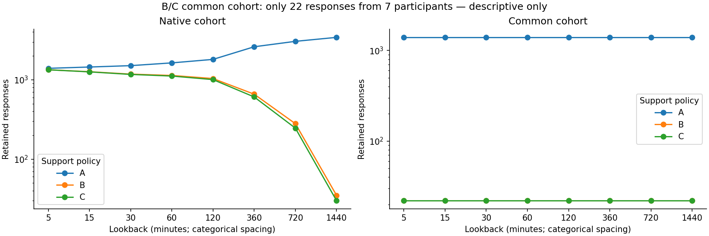
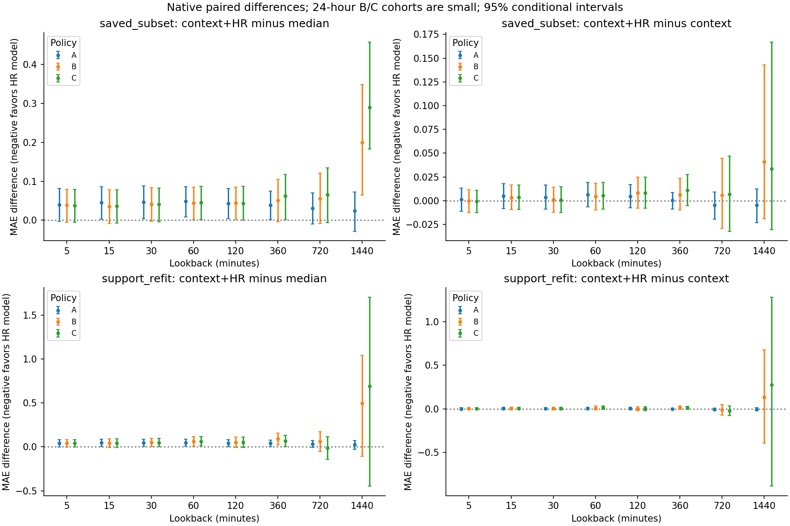
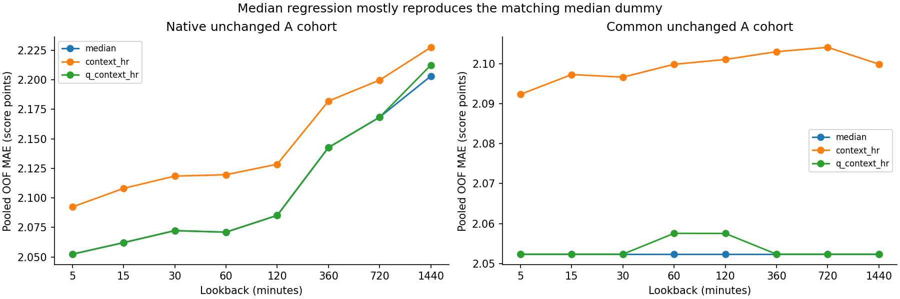
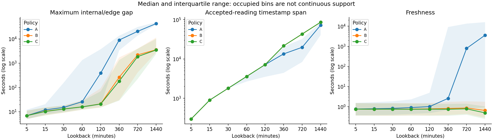

# Notebook 06 — recording-support and median-loss follow-up

**Denser/more recent recordings did not produce a consistent HR advantage. Median regression
mostly recovered the already competitive median dummy rather than adding HR information.**
This is a **prospectively specified exploratory follow-up informed by Notebook 05**, not an
independent preregistered confirmation. Timing questions remain unresolved: exploratory prediction
from recorded pre-EMA data is not validated real-time prediction. No optimal window or threshold
is declared.

## Questions and rules fixed before new comparisons

[The frozen specification](../../hr_support_loss_specification.md) asks whether denser/recent HR
helps, and whether a median-oriented loss improves MAE relative to squared-error Ridge. Continuous
three-item PSS coding, all eight lookbacks, HR mean/SD/latest/slope, context, original five folds and
all 3,706 linked rows are unchanged. No binary cutoff, imputation or new activity feature.

- **A:** existing complete-case HR support.
- **B:** A plus ≥80% of lookback minute bins containing accepted HR readings.
- **C:** B plus latest accepted reading ≤60 seconds before the cutoff.

These are fixed provisional sensitivity choices, not validated device standards. Existing occupancy
already counts accepted readings after clock/value/conflict rules. All **29,648 HR lookbacks** were
independently checked against the preserved accepted-reading ledger, using [left,right) bin searches
and Python integer offsets. Bins are anchored at cutoff−lookback; an observation at cutoff is
excluded. Features were not changed. Occupied bins do not establish continuous recording.

## Coverage and sample loss

| lookback_minutes | responses_A | responses_B | responses_C | participants_A | participants_B | participants_C |
| --- | --- | --- | --- | --- | --- | --- |
| 5 | 1,395 | 1,339 | 1,337 | 117 | 116 | 116 |
| 15 | 1,449 | 1,264 | 1,259 | 118 | 112 | 111 |
| 30 | 1,508 | 1,179 | 1,169 | 118 | 108 | 107 |
| 60 | 1,634 | 1,134 | 1,115 | 118 | 105 | 104 |
| 120 | 1,808 | 1,037 | 1,006 | 119 | 101 | 97 |
| 360 | 2,608 | 659 | 608 | 123 | 89 | 87 |
| 720 | 3,053 | 280 | 246 | 123 | 63 | 57 |
| 1,440 | 3,426 | 35 | 30 | 123 | 9 | 8 |

At five minutes, B/C retain 96.0%/95.8% of the A responses. At 24 hours this falls to 1.0%/0.9%:
**35 responses from nine participants for B; 30 from eight for C**. The common intersection across
all eight lookbacks contains **22 responses from seven participants for both B and C**, versus
1,395/117 for A. Those intersections and the 24-hour B/C cohorts are explicitly flagged small;
their results are descriptive and cannot support a reliable lookback comparison. No folds were
redrawn and no threshold relaxed. All folds were numerically feasible, including these small fits.

Every cohort/fold's training and validation counts are in `fold_counts.json`. All development EMAs
have explicit inclusion reasons in the private membership table, including those outside the
original complete-case cohort. `composition.json` and the [readable retained/excluded appendix](retained_excluded.md)
report response/participant counts, survey composition and outcome mean/SD/median/quartiles/range.
The denominator for a support loss is the matching A cohort, not the entire development set.
Participants may contribute responses to both retained and excluded groups.

## Saved predictions versus support-cohort refitting

`saved_subset` filters validation predictions saved by Notebook 05; its training population and
matching dummies/context models remain unchanged. `support_refit` retrains all five comparators on
the policy cohort inside each frozen fold. Within each comparison, training and validation membership
is identical across models. Saved common-subset predictions come from the original common-cohort
fits. These two stages must not be interpreted as the same intervention.

The following native-cohort MAEs show their separation. `context_hr` is Ridge with context and HR.
Every row compares models on the same validation responses. Different rows may contain different
people/responses; lower unpaired error across rows is not evidence of a better policy.

| policy | lookback_minutes | saved_subset_median | saved_subset_context | saved_subset_context_hr | support_refit_median | support_refit_context | support_refit_context_hr |
| --- | --- | --- | --- | --- | --- | --- | --- |
| B | 5 | 2.041 | 2.080 | 2.079 | 2.041 | 2.080 | 2.082 |
| B | 15 | 2.052 | 2.084 | 2.088 | 2.052 | 2.091 | 2.095 |
| B | 30 | 2.047 | 2.087 | 2.089 | 2.047 | 2.092 | 2.097 |
| B | 60 | 2.037 | 2.076 | 2.081 | 2.037 | 2.089 | 2.100 |
| B | 120 | 2.030 | 2.066 | 2.074 | 2.030 | 2.083 | 2.084 |
| B | 360 | 2.011 | 2.056 | 2.062 | 2.011 | 2.087 | 2.100 |
| B | 720 | 2.011 | 2.061 | 2.067 | 2.011 | 2.082 | 2.071 |
| B | 1,440 | 1.971 | 2.130 | 2.171 | 1.829 | 2.188 | 2.323 |
| C | 5 | 2.039 | 2.078 | 2.077 | 2.039 | 2.078 | 2.080 |
| C | 15 | 2.050 | 2.083 | 2.086 | 2.050 | 2.088 | 2.093 |
| C | 30 | 2.047 | 2.087 | 2.088 | 2.047 | 2.091 | 2.096 |
| C | 60 | 2.028 | 2.067 | 2.073 | 2.028 | 2.077 | 2.091 |
| C | 120 | 2.021 | 2.057 | 2.065 | 2.021 | 2.071 | 2.074 |
| C | 360 | 2.007 | 2.058 | 2.069 | 2.007 | 2.061 | 2.074 |
| C | 720 | 2.000 | 2.059 | 2.065 | 2.024 | 2.034 | 2.013 |
| C | 1,440 | 1.800 | 2.056 | 2.089 | 1.533 | 1.944 | 2.222 |

Filtering alone often lowers errors for **all** models, including the dummy. That is an evaluation-
population change, not evidence of stronger HR signal. Refit versus saved contrasts on the exact
same validation rows are in `retraining_intervals.json`. For C at 12 hours, context+HR refitting
changes MAE by −0.053 (95% interval −0.147 to +0.049); uncertainty includes no retraining gain.

The most favorable native context+HR point comparison is C at 12 hours: **MAE 2.013**, versus
matching median **2.024** and context **2.034**. Differences are **−0.012 [−0.141,+0.117]** versus
median and **−0.021 [−0.077,+0.036]** versus context. It retains only **246 responses / 57 participants**,
excluding **2,807 of 3,053** A responses (91.9%). It is an uncertain exploratory exception, not a
selected window or evidence that C is optimal. All native B/C context+HR-versus-context intervals
include zero:

| policy | lookback_minutes | mae_difference | mae_difference_low | mae_difference_high |
| --- | --- | --- | --- | --- |
| B | 5 | 0.002 | -0.009 | 0.013 |
| B | 15 | 0.004 | -0.008 | 0.017 |
| B | 30 | 0.005 | -0.012 | 0.020 |
| B | 60 | 0.011 | -0.012 | 0.035 |
| B | 120 | 0.001 | -0.022 | 0.023 |
| B | 360 | 0.013 | -0.007 | 0.033 |
| B | 720 | -0.011 | -0.071 | 0.052 |
| B | 1,440 | 0.135 | -0.394 | 0.678 |
| C | 5 | 0.002 | -0.009 | 0.013 |
| C | 15 | 0.005 | -0.007 | 0.017 |
| C | 30 | 0.005 | -0.012 | 0.021 |
| C | 60 | 0.013 | -0.007 | 0.033 |
| C | 120 | 0.002 | -0.019 | 0.026 |
| C | 360 | 0.013 | -0.006 | 0.031 |
| C | 720 | -0.021 | -0.077 | 0.036 |
| C | 1,440 | 0.278 | -0.888 | 1.285 |

Small common-cohort fits sometimes have lower point error than a comparator, but only seven
participants determine those results. [All pooled metrics](pooled_metrics.md) retain those results
with the cohort warnings; they are not used to choose a winner.

## Median-loss baseline, separately on unchanged A cohorts

QuantileRegressor(quantile=.5, alpha=.01, solver='highs') uses the same training-only numerical
scaling and categorical encoding as Ridge. No median model is fitted on B or C. The fixed alphas
are **not comparable penalties**: Ridge has squared loss/L2 regularization; QuantileRegressor has
average pinball loss/L1 regularization. At .5, pinball loss is half absolute error. This experiment
tests this specific loss-plus-penalty choice, not a pure isolated loss effect. Official
[QuantileRegressor documentation](https://scikit-learn.org/stable/modules/generated/sklearn.linear_model.QuantileRegressor.html)
and the installed source are recorded in the specification; scikit-learn is 1.9.1.

All **240 median-regression fits converged**, with no convergence warnings. **234/240** have constant
validation predictions at eight decimal places; six have nonzero coefficient/prediction variation.
The constant predictions equal the matching training median, 6. No alpha was changed to force
variation. The six varying fits occur in common-cohort 60/120-minute HR models and native 24-hour
HR models. `quantile_fit_diagnostics.json` records iterations, objectives, variation and coefficient
counts, while `prediction_variability.json` gives pooled prediction ranges/SDs and dummy agreement.
All fitted objectives are no worse than the feasible constant-training-median solution.

| scope | lookback_minutes | context | context_hr | hr | mean | median | q_context | q_context_hr | q_hr |
| --- | --- | --- | --- | --- | --- | --- | --- | --- | --- |
| common | 5 | 2.091 | 2.092 | 2.096 | 2.096 | 2.052 | 2.052 | 2.052 | 2.052 |
| common | 15 | 2.091 | 2.097 | 2.101 | 2.096 | 2.052 | 2.052 | 2.052 | 2.052 |
| common | 30 | 2.091 | 2.097 | 2.100 | 2.096 | 2.052 | 2.052 | 2.052 | 2.052 |
| common | 60 | 2.091 | 2.100 | 2.104 | 2.096 | 2.052 | 2.052 | 2.058 | 2.058 |
| common | 120 | 2.091 | 2.101 | 2.104 | 2.096 | 2.052 | 2.052 | 2.058 | 2.058 |
| common | 360 | 2.091 | 2.103 | 2.105 | 2.096 | 2.052 | 2.052 | 2.052 | 2.052 |
| common | 720 | 2.091 | 2.104 | 2.108 | 2.096 | 2.052 | 2.052 | 2.052 | 2.052 |
| common | 1,440 | 2.091 | 2.100 | 2.105 | 2.096 | 2.052 | 2.052 | 2.052 | 2.052 |
| native | 5 | 2.091 | 2.092 | 2.096 | 2.096 | 2.052 | 2.052 | 2.052 | 2.052 |
| native | 15 | 2.103 | 2.108 | 2.109 | 2.105 | 2.062 | 2.062 | 2.062 | 2.062 |
| native | 30 | 2.115 | 2.118 | 2.119 | 2.116 | 2.072 | 2.072 | 2.072 | 2.072 |
| native | 60 | 2.113 | 2.120 | 2.120 | 2.115 | 2.071 | 2.071 | 2.071 | 2.071 |
| native | 120 | 2.124 | 2.129 | 2.130 | 2.127 | 2.085 | 2.085 | 2.085 | 2.085 |
| native | 360 | 2.182 | 2.182 | 2.183 | 2.184 | 2.143 | 2.143 | 2.143 | 2.143 |
| native | 720 | 2.204 | 2.200 | 2.201 | 2.207 | 2.168 | 2.168 | 2.168 | 2.168 |
| native | 1,440 | 2.232 | 2.227 | 2.233 | 2.239 | 2.203 | 2.203 | 2.212 | 2.212 |

For native 5–720-minute cohorts, the quantile models equal the median dummy to numerical precision.
They therefore improve context+HR Ridge MAE by about **0.031–0.049 points**, without an HR-specific
gain. At 24 hours quantile context+HR MAE is **2.212**, versus median **2.203**: difference
**+0.009 [−0.003,+0.022]**. In the common A cohort, varying 60/120-minute quantile models are about
0.005 points worse than median; other windows reproduce the dummy. No quantile context+HR result
provides a convincing advantage beyond the matching median/context-quantile baseline.

Native quantile context+HR minus matched context+HR Ridge differences:

| lookback_minutes | mae_difference | mae_difference_low | mae_difference_high |
| --- | --- | --- | --- |
| 5 | -0.040 | -0.081 | 0.002 |
| 15 | -0.046 | -0.086 | -0.003 |
| 30 | -0.046 | -0.088 | -0.004 |
| 60 | -0.049 | -0.087 | -0.008 |
| 120 | -0.043 | -0.081 | -0.004 |
| 360 | -0.039 | -0.075 | -0.002 |
| 720 | -0.031 | -0.070 | 0.010 |
| 1,440 | -0.015 | -0.062 | 0.034 |

`metrics.json` includes pooled and fold **MAE, RMSE and participant-averaged MAE**. At five minutes,
quantile context+HR equals median: MAE 2.052, RMSE 2.563, participant-MAE 2.181; Ridge context+HR
has 2.092, 2.548, 2.220. Better primary MAE does not imply better secondary RMSE.

## Survey-category errors and recording diagnostics

Category errors for representative endpoints are below; all categories/stages/policies/lookbacks
are retained in `metrics.json`. No category-specific model was fitted.

| lookback_minutes | survey_category | context_hr | median | q_context_hr |
| --- | --- | --- | --- | --- |
| 5 | Endday | 2.042 | 1.995 | 1.995 |
| 5 | Midday | 2.105 | 2.061 | 2.061 |
| 5 | Morning | 2.130 | 2.122 | 2.122 |
| 1,440 | Endday | 2.183 | 2.152 | 2.161 |
| 1,440 | Midday | 2.224 | 2.191 | 2.198 |
| 1,440 | Morning | 2.283 | 2.284 | 2.298 |

Morning items ask **since waking**; Midday/Endday refer to **since the last prompt**. Those recall
periods need not equal any of these fixed lookbacks. No waking time or preceding-prompt time was
inferred from completed surveys, and a survey label does not prove an end-of-day recall period.
Category differences are descriptive, not grounds for choosing an outcome definition.

`quality_diagnostics.json` retains accepted-reading counts, occupancy, freshness, span and maximum
internal/edge gaps for retained/excluded groups. Two readings do not establish representative
coverage, and even an occupied bin can contain only one point. B/C constrain density/freshness,
not physiological continuity, acquisition timing or absence of batching. Quality remains outside
the predictor matrix. No missing data are filled, and overlapping windows are not independent.

## Uncertainty and next experiment

Intervals use **2,000 paired participant-cluster bootstrap resamples** of fixed out-of-fold
predictions. All responses for a sampled participant move together. They omit model-refitting
uncertainty and are not external validation or multiplicity-adjusted tests. Many overlapping
lookbacks, policies, populations and models were examined after Notebook 05; isolated improvements
should not be treated as confirmations. Small-cohort intervals, particularly with seven participants,
are unstable even when numerical fitting is possible.

**Recommendation:** resolve timestamp/batching and intended survey recall periods before expanding
models. If explicit wake/notification times are available and their meaning is confirmed, specify
a development-only recall-aligned HR experiment using the same fixed median/Ridge comparators and
matched cohorts. Do not synthesize those times from previous completed surveys. The current results
do not support threshold/alpha searching, a winning lookback, expanded HRV or opening final-test data.
[Provider questions](../../hr_support_loss_provider_questions_draft.md) are drafted locally only,
not sent. The loss result chiefly explains why the simple median dummy is hard to beat on MAE;
it does not establish that regularization or recording support caused all weak HR results.

## Artifacts and verification

- Frozen specification: `reports/hr_support_loss_specification.md`; config: `config/hr_support_loss.json`.
- Private cohort inclusion: `private/hr_support_loss/runs/c9caf911d30a6271/membership.parquet` — 177,888 rows.
- Private predictions: `private/hr_support_loss/runs/c9caf911d30a6271/predictions.parquet` — 112,221 cohort/EMA views.
- Verified support: `private/hr_support_loss/runs/c9caf911d30a6271/verified_hr_support.parquet` — 29,648 HR windows.
- Existing linked data remain unchanged at `private/ema_baseline/runs/640600af77404ff6/linked_development.parquet`.
- Notebook: `notebooks/06_hr_support_and_loss.ipynb`; executed copies belong under ignored `outputs/`.
- All aggregate tables, four figures and readable appendices: `reports/hr_support_loss/838b9efbf4bfd731`.

All 32 final-test participants remain sealed. Corrected provenance, raw files, previous bundles,
score coding and original assignments/folds are preserved. No new activity features, expanded HRV,
Garmin stress predictors, nonlinear models, imputation, feature selection, commit or push.
The separate verification record documents tests, notebook execution, privacy and integrity checks.
