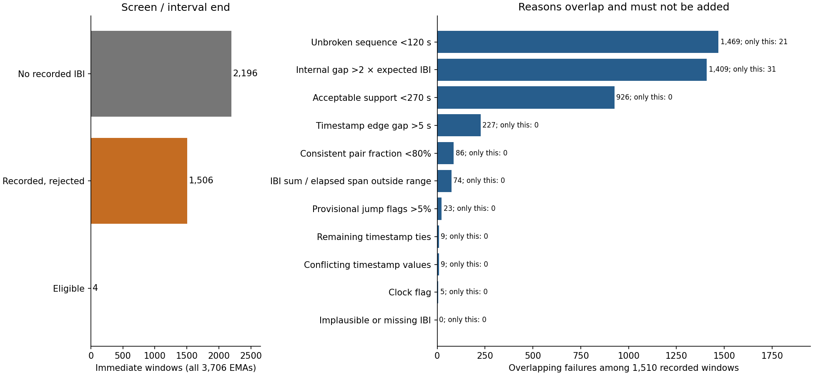
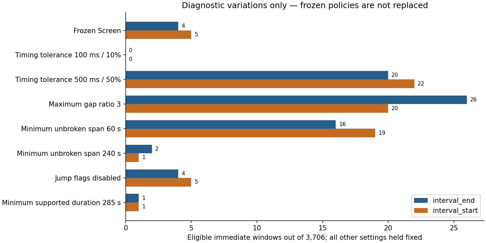
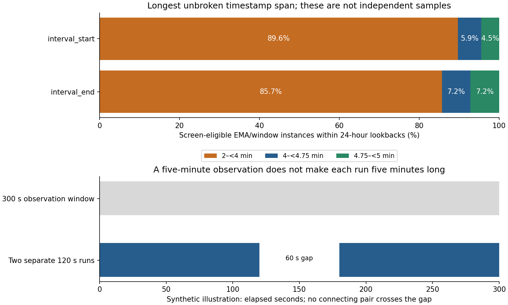

# HRV input validation and explanation of eligibility losses

**No real-data HRV was calculated.** All analyses use the 125 development participants and the
existing immutable bundles. All 32 final-test participants remain sealed. No PSS targets, imputation,
feature linkage, models, commit or push were performed. Frozen policies and assignments are unchanged.

## Verified development findings

Of **3,706 immediate five-minute windows, 2,196 (59.3%) have no recorded IBI**; 1,510 contain records.
Under Screen/end, 1,506 of those recorded windows fail and four pass. Seven recorded windows have
fewer than two contained plausible intervals. Under Screen/start the corresponding counts are 1,505
failures, five passes and ten with fewer than two contained intervals. Recorded but insufficient
windows are a subset of recorded failures, not an additional attrition stage.

| policy | scenario | ema_windows | no_recorded_ibi | recorded_rejected | recorded_fewer_than_two_contained | eligible | eligible_participants |
| --- | --- | --- | --- | --- | --- | --- | --- |
| conservative | interval_end | 3706 | 2196 | 1510 | 7 | 0 | 0 |
| conservative | interval_start | 3706 | 2196 | 1510 | 10 | 0 | 0 |
| screen | interval_end | 3706 | 2196 | 1506 | 7 | 4 | 4 |
| screen | interval_start | 3706 | 2196 | 1505 | 10 | 5 | 5 |
| timing_sensitivity | interval_end | 3706 | 2196 | 1490 | 7 | 20 | 16 |
| timing_sensitivity | interval_start | 3706 | 2196 | 1488 | 10 | 22 | 17 |

The principal losses among recorded Screen/end windows are **unbroken span <120 s (1,469)**,
**an internal gap >2× expected IBI (1,409)** and **acceptable support <270 s (926)**. Only 86 fail the
80% pair-agreement fraction, but *each* inconsistent pair can still break a run even if the overall
fraction passes. Therefore a high percentage of matching pairs does not imply a long intact sequence.
The two most frequent recorded-failure combinations are gap + support + run length (636), and
gap + run length (527). Reasons overlap and must not be summed.

| reason | overlapping | only_this_check | pass_if_only_gate_waived |
| --- | --- | --- | --- |
| clock_flag | 5 | 0 | 4 |
| conflicting_timestamp_values | 9 | 0 | 4 |
| duration_elapsed_mismatch | 74 | 0 | 4 |
| excessive_artifact_flags | 23 | 0 | 4 |
| excessive_internal_gap_ratio | 1409 | 31 | 35 |
| fewer_than_two_contained_intervals | 7 | 0 | 4 |
| implausible_or_missing_ibi | 0 | 0 | 4 |
| insufficient_edge_support | 227 | 0 | 4 |
| insufficient_interval_time_agreement | 86 | 0 | 4 |
| insufficient_supported_duration | 926 | 0 | 4 |
| insufficient_unbroken_sequence | 1469 | 21 | 25 |
| no_recorded_ibi | 2196 | 2196 | 4 |
| repeated_timestamp | 9 | 0 | 4 |

Only 31 windows fail solely the gap-ratio gate, and 21 solely the run-span gate. No other recorded
Screen/end window fails only one gate. The gate-waiver column removes a final decision bit without
changing interval membership, support or run construction; it is a logical dependency diagnostic,
**not permission to use those windows**. It always requires recorded IBI; absence is never waived.
Complete reason overlaps, combinations and survey categories are in the companion JSON tables.

## Diagnostic changes, not replacement policies

The separate diagnostic configuration was saved before its comparisons. These are single-check or
single-mechanism sensitivities around Screen, never selected using outcomes or a retention target.
Timing-tolerance changes also alter which pairs break runs; jump-threshold changes recompute flagged
intervals, support and runs. Raising a final allowed flag fraction alone does not undo exclusions.

| variation | scenario | eligible | eligible_participants |
| --- | --- | --- | --- |
| baseline | interval_end | 4 | 4 |
| baseline | interval_start | 5 | 5 |
| duration_ratio_0_7_to_1_3 | interval_end | 4 | 4 |
| duration_ratio_0_7_to_1_3 | interval_start | 5 | 5 |
| duration_ratio_0_9_to_1_1 | interval_end | 4 | 4 |
| duration_ratio_0_9_to_1_1 | interval_start | 5 | 5 |
| edge_gap_10s | interval_end | 4 | 4 |
| edge_gap_10s | interval_start | 5 | 5 |
| edge_gap_2_5s | interval_end | 4 | 4 |
| edge_gap_2_5s | interval_start | 5 | 5 |
| flag_fraction_10pct | interval_end | 4 | 4 |
| flag_fraction_10pct | interval_start | 5 | 5 |
| flag_fraction_1pct | interval_end | 4 | 4 |
| flag_fraction_1pct | interval_start | 5 | 5 |
| jump_flags_disabled_diagnostic | interval_end | 4 | 4 |
| jump_flags_disabled_diagnostic | interval_start | 5 | 5 |
| jump_threshold_10pct | interval_end | 2 | 2 |
| jump_threshold_10pct | interval_start | 1 | 1 |
| jump_threshold_30pct | interval_end | 4 | 4 |
| jump_threshold_30pct | interval_start | 5 | 5 |
| maximum_gap_ratio_1_5 | interval_end | 2 | 2 |
| maximum_gap_ratio_1_5 | interval_start | 2 | 2 |
| maximum_gap_ratio_3 | interval_end | 26 | 19 |
| maximum_gap_ratio_3 | interval_start | 20 | 17 |
| pair_agreement_50pct | interval_end | 4 | 4 |
| pair_agreement_50pct | interval_start | 5 | 5 |
| pair_agreement_95pct | interval_end | 4 | 4 |
| pair_agreement_95pct | interval_start | 5 | 5 |
| pair_tolerance_100ms_10pct | interval_end | 0 | 0 |
| pair_tolerance_100ms_10pct | interval_start | 0 | 0 |
| pair_tolerance_500ms_50pct | interval_end | 20 | 16 |
| pair_tolerance_500ms_50pct | interval_start | 22 | 17 |
| plausibility_300_to_2000ms | interval_end | 4 | 4 |
| plausibility_300_to_2000ms | interval_start | 5 | 5 |
| supported_duration_240s | interval_end | 4 | 4 |
| supported_duration_240s | interval_start | 5 | 5 |
| supported_duration_285s | interval_end | 1 | 1 |
| supported_duration_285s | interval_start | 1 | 1 |
| unbroken_span_240s | interval_end | 2 | 2 |
| unbroken_span_240s | interval_start | 1 | 1 |
| unbroken_span_60s | interval_end | 16 | 14 |
| unbroken_span_60s | interval_start | 19 | 17 |

Disabling the provisional >20% jump flags leaves retention at **4/end and 5/start**. It is not the
main explanation for the severe loss, and those flags do not prove artifact or ectopy. Widening the
pair tolerance to 500 ms/50% retains 20/end and 22/start; raising the gap ratio to three retains
26/end and 20/start. Neither result validates a wider rule or the acquisition clock. Reducing the
minimum run to 60 s retains 16/end and 19/start, illustrating the duration tradeoff, not recommending it.
Plausibility, conflict and edge failures matter locally even when changing their gate cannot rescue
windows that fail several other checks.

## Precision, batching and clocks

The original IBI timestamp strings have mostly six or seven nonzero fractional decimal places:
**29,356,723 of 34,427,546 physical IBI rows**.
Only 2,706 physical timestamps have no nonzero fractional part.
This rules out a simple whole-second export representation as the universal explanation. Decimal
precision is not measurement accuracy or proof of acquisition timing.

The logical development stream contains **504,202 compressed positive-time pairs**
spaced less than one quarter of both adjacent IBI durations, 3,190 timestamp ties,
33,766 gaps above five seconds and 5,202 above one minute. These patterns
are compatible with delayed or batched receipt, missing records or exporter behavior; they do not
identify the mechanism. No timestamp was shifted, rounded, reconstructed or concatenated.

As a precision-bound diagnostic, widening an *absolute pair comparison* from 250 to 251 ms changes
end-hypothesis matching pairs from 31,977,881 to 31,992,259
(out of 34,423,761 positive plausible pairs). This is not a policy rerun or a
retiming operation. Millisecond quantization alone would not account for the much larger mismatches;
clock jitter or batching can be much larger than the displayed precision. Only
2,627,765 pairs match current IBI within NeuroKit's 10 ms native criterion.

## Observation duration versus uninterrupted input

A five-minute window has 300 seconds of calendar duration. Its acceptable supported duration is a
union of hypothesized intervals with holes preserved. Its longest provisional run is a separate
first-to-last timestamp span. Neither should be substituted for the other.

| scenario | scope | windows | span_120_to_240s | span_240_to_285s | span_285_to_300s |
| --- | --- | --- | --- | --- | --- |
| interval_end | all_24h_instances | 18964 | 16247 | 1357 | 1360 |
| interval_end | immediate | 4 | 2 | 1 | 1 |
| interval_start | all_24h_instances | 14681 | 13161 | 866 | 654 |
| interval_start | immediate | 5 | 4 | 0 | 1 |

Within 24-hour lookbacks, **16,247/18,964 Screen/end eligible window instances** and
**13,161/14,681 Screen/start instances** have longest runs below four minutes. These are overlapping
EMA/window instances, not independent segments. A two-minute run may pass Screen; its future
calculation must be labeled by the actual run duration and cannot be called five-minute HRV.

The [input specification](../../hrv_input_specification.md) defines membership, run breaks, package
conditions and formulas. Every approved window has an ignored immutable slice index; the original
values and quality flags remain in normalized Parquet. The reusable loader hydrates any window.
Immediate-window records and run boundaries are additionally materialized for review:
**5,321,816 window-index rows, 3,720,564 member/policy/scenario rows,
and 637,390 run rows**. Repeated case rows are reference views, not new beats.
Private diagnostics: `private/hrv_input_validation/diagnostics/bc13763b35972be4`.

| policy | scenario | runs | allowed_adjacent_pairs | native_neurokit_compatible_pairs | pilot_candidate_runs |
| --- | --- | --- | --- | --- | --- |
| conservative | interval_end | 235050 | 378647 | 46031 | 0 |
| conservative | interval_start | 243795 | 369743 | 45600 | 0 |
| screen | interval_end | 50848 | 562850 | 46031 | 1 |
| screen | interval_start | 53363 | 560176 | 46013 | 1 |
| timing_sensitivity | interval_end | 27195 | 586503 | 46031 | 10 |
| timing_sensitivity | interval_start | 27139 | 586400 | 46013 | 10 |

## Verified synthetic package behavior

Installed versions: NeuroKit2 **0.2.13**, HeartPy **1.2.7**, NumPy **2.2.6**, SciPy **1.17.1**.
Their installed source/docstrings and signatures were inspected and hashed. The environment was
extended in place; the existing direct dependency pins remain unchanged. A private copy of the
prior lockfile was preserved. Adding package dependencies changes the current lock hash; this
checkpoint explicitly reuses existing bundles and does not regenerate normalization.

**13 synthetic cases produced 30 run/backend checks:
26 matched independent reference arithmetic and 4 were deliberately blocked**
because NeuroKit native pair rules or timestamp anchoring did not match the contract. Cases cover
known intervals, constants, exact 50 ms differences, jitter, gaps, removed/rejected records,
remaining duplicates, conflicts and both window-boundary hypotheses. The adapters accept synthetic
fixtures only and refuse changed clocks, multi-run concatenation or new adjacent pairs.

For the known synthetic sequence **800, 900, 1000, 950, 850 ms**, mean and median are 900 ms.
Sample SDNN is sqrt(25,000/4) = **79.056942 ms**. The differences are +100, +100, −50, −100 ms;
RMSSD is sqrt(32,500/4) = **90.138782 ms** and pair-denominator pNN50 is **75%** (three of four,
strictly greater than 50 ms). These are synthetic illustration values only.

| backend | mean_ibi_ms | median_ibi_ms | sdnn_sample_ms | rmssd_ms | pnn50_pairs_percent |
| --- | --- | --- | --- | --- | --- |
| heartpy | 900.000 | unavailable | 79.057 | 90.139 | 75.000 |
| neurokit2 | 900.000 | 900.000 | 79.057 | 90.139 | 75.000 |

HeartPy's native SDNN uses population variance (70.710678 ms in this example); convert by
sqrt(N/(N−1)). Its pNN50 is 0.75 as a proportion; multiply by 100. It exposes no median IBI result.
NeuroKit uses sample SDNN but native pNN50 is 60% here, dividing by P+1 instead of P. The adapters
perform explicit documented conversions only after pair identity is verified.

NeuroKit's explicit `RRI`/`RRI_Time` interface is timestamp-aware, but native succession uses current
IBI and 10 ms tolerance. Synthetic jitter with **some** matching pairs triggers pair filtering;
jitter with **no** matching pairs can bypass that filter and use all differences. Its apparent
success is therefore not evidence of valid input. Negative-control results are in
`synthetic_validation.json`; they are not approved gappy-input adapters. Start-anchored timestamps
are not silently shifted into end times to satisfy the package.

HeartPy's high-level `process_rr` is not used: it lacks timestamps and attempts Poincaré/breathing
calculations even with frequency output disabled. Its lower-level `calc_ts_measures` accepts the
externally validated absolute differences and does not correct/interpolate data. No waveform,
spectral, breathing or nonlinear function was used. NeuroKit's other time-domain outputs are not
validated or retained. HeartPy emits a deprecated `pkg_resources` warning; small/constant synthetic
cases can emit numerical warnings for unused ancillary NeuroKit summaries. Warnings are recorded;
the specified outputs are explicitly checked.

## Provisional assumptions and provider questions

Verified facts above concern exports, code and arithmetic. IBI millisecond units, sensor modality,
beat/interval interpretation, clock accuracy, normal-beat status and the frozen numerical screens
remain provisional. Only the provider can establish whether `ts` is acquisition, buffering or
receipt time; whether it anchors interval start/end; how batching and missing beats are represented;
and whether quality or beat-type annotations exist. No retention comparison answers those questions.
The >20% change flag is not a validated artifact detector.

## Concrete next pilot

The arithmetic and single-run guards are ready for **mean/median IBI, sample-convention SDNN,
RMSSD and pair-denominator pNN50**, conditional on a documented interpretation of the source.
A next development-only pilot should select at most ten unique nonoverlapping runs, at most one per
participant, from frozen Screen-eligible windows with **run span ≥240 s AND support ≥240 s**.
Use deterministic chronological selection without outcomes or HRV values. Label actual run duration;
keep both timestamp hypotheses separate. The immediate windows contain only **one window meeting
that pilot restriction under both hypotheses**; do not loosen rules to reach ten. Longer lookbacks
can be inspected via the same indexed contract, with overlap deduplication before selection.

Use HeartPy's validated lower-level time-domain call or the independent formulas with externally
verified adjacency. Use NeuroKit for pair-based cross-checks only when interval-end interpretation
and its exact pair set agree. Until normal-beat status is established, report IBI variability with
NN status unverified. No real pilot values were calculated here. Spectral and additional nonlinear
features remain deferred; Garmin stress derivatives and quality diagnostics remain outside initial
predictors.

Sources: [NeuroKit API/source](https://neuropsychology.github.io/NeuroKit/_modules/neurokit2/hrv/hrv_time.html),
[HeartPy time-domain source](https://python-heart-rate-analysis-toolkit.readthedocs.io/en/latest/_modules/heartpy/analysis.html),
[HeartPy RR pipeline](https://python-heart-rate-analysis-toolkit.readthedocs.io/en/latest/_modules/heartpy/heartpy.html).
Installed source hashes in `synthetic_validation.json` identify the tested implementation.
