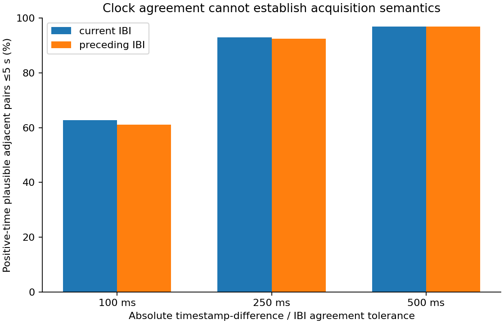
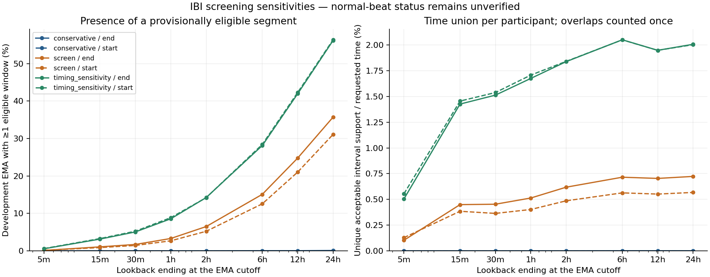

# Development preprocessing and five-minute IBI eligibility

The checkpoint preserves **3,706 development EMA records from 125 participants**, and **57,552,038 original sensor records from 123 development participants**. All 32 final-test participants remain sealed; their 31 available sensor sources were skipped before CSV parsing. Exact frozen assignments and the five development folds are unchanged. No PSS target, HRV, imputation, reconstructed beats, final prediction dataset or model was produced.

## Data organization and preservation

Normalized bundle: `private/preprocessing/normalized/31e51c934bcdeffa`.

- `ema/development_ema.parquet`: all development EMA rows, raw strings, source schema/hash/row, participant provenance, original fold, clocks and cutoff flags. Survey items remain raw; no target is calculated.
- `physical/<partition>/<sensor>.parquet`: every original Garmin row plus provenance, parsed time/value and quality flags. Original columns are unchanged strings; absent source columns remain null and are distinguishable from blanks through the source-schema record.
- `logical/<partition>/<sensor>.parquet`: stable source/row references and parsed diagnostics after collapsing exact duplicates only. Raw values are recovered using `n_physical_row`.
- Private source catalog, participant-directory map and immutable content manifest.

The physical view retains all copies. The logical view has **57,551,189 rows**, with **849 exact-record excess rows** collapsed for logical analysis. **6,120 physical rows** belong to conflicting timestamp/value groups (across all sensors). Neither same-valued intervals at different times nor nonidentical records with matching timestamp/value are arbitrarily removed. Conflicting IBI records are never averaged; windows with remaining timestamp ties fail all policies. Original export order is retained by source/row provenance; chronological logical ordering does not prove acquisition order.

Sources were processed in bounded CSV chunks, then participant/sensor partitions. Raw values and provenance were compared after Parquet round-trips. Version directories are content-addressed; existing complete bundles are verified and reused, never overwritten.

EMA UTC is local time minus the row offset (minutes local-minus-UTC). Garmin Unix `ts` receives no timezone shift. Cutoff is actual UTC minus 60 seconds for minute precision, otherwise actual UTC for second precision. Clock disagreements and unusual offsets remain flags; no time is shifted to increase coverage. The sensor dictionary’s units remain exporter assumptions pending documentation.

## Policies and interval-boundary uncertainty

The exact definitions were saved before retention comparison in [the policy specification](../../ibi_eligibility_policies.md) and `config/ibi_eligibility.json`. The audit manifest records both hashes. Conservative, screen and timing_sensitivity are provisional alternatives, not validated eligibility rules. No policy was tuned to PSS associations or desired sample size. The third changes only the broader screen’s time tolerance. All require plausible intervals, no remaining timestamp ties/conflicts or clock flags, bounded expected-interval gaps and edge gaps, sufficient hypothetical support, a long enough unbroken sequence, bounded abrupt-change flags and interval-sum/elapsed-time agreement.

Both interval-end and interval-start interpretations are carried through every result. Entire hypothesized intervals must fit inside the left-inclusive/right-exclusive timestamp window. Cross-boundary intervals remain raw records and receive explicit diagnostic exclusion counts. They are not corrected or borrowed from outside the window. Artifact flags use only pairs within the scenario’s contained subset; no post-window observation can alter a window’s eligibility. Every removed/rejected interval and failed pair breaks adjacency. Normal-beat status is **unverified** for every interval, including those passing all screens.

## What the IBI clocks show

The logical development IBI stream has 34,427,074 records, 3,190 zero timestamp differences, 33,766 gaps above five seconds and 3,434 gaps above five minutes. 504,202 pairs have timestamps separated by less than one quarter of both associated IBI durations. There are 178,498 such compressed-spacing clusters; the largest contains 1,847 pairs. 0 retained logical rows have an export-order timestamp reversal relative to the previous same-sensor source row.

| expected_interval | tolerance_seconds | positive_pairs_within_5s | matching_pairs | matching_percent |
| --- | --- | --- | --- | --- |
| current | 0.100 | 34389995 | 21550723 | 62.666 |
| current | 0.250 | 34389995 | 31977881 | 92.986 |
| current | 0.500 | 34389995 | 33327702 | 96.911 |
| preceding | 0.100 | 34389995 | 21024379 | 61.135 |
| preceding | 0.250 | 34389995 | 31807508 | 92.491 |
| preceding | 0.500 | 34389995 | 33328910 | 96.915 |

Current-IBI agreement is consistent with interval-end anchoring; preceding-IBI agreement is consistent with interval-start anchoring. Similar intervals can fit both explanations. Compressed spacing, ties, reversals and imperfect agreement are compatible with buffering/receipt timing, clock jitter or exporter behavior. They do not identify which mechanism occurred. These comparisons cannot prove acquisition semantics or validate reconstructed beat times. Signed and absolute residual quantiles, compressed-spacing counts and long-gap counts are in `timing.json`.

## Coverage and attrition

**5,321,816 five-minute window instances** were enumerated at one-minute steps, with all six policy/scenario results stored per window. The private EMA accounting table has **177,888 rows** (one per EMA/policy/scenario/lookback). Every development EMA is retained in denominators, including participants without Garmin or eligible windows. No filtering on valid PSS items was performed. A window belongs to a lookback only if its full five-minute support lies inside it.

| policy | scenario | lookback_minutes | eligible_windows | eligible_ema | ema_denominator | eligible_participants | unique_supported_minutes | unique_requested_minutes |
| --- | --- | --- | --- | --- | --- | --- | --- | --- |
| conservative | interval_end | 5 | 0 | 0 | 3706 | 0 | 0.000 | 18,530.000 |
| conservative | interval_end | 15 | 0 | 0 | 3706 | 0 | 0.000 | 55,573.167 |
| conservative | interval_end | 30 | 0 | 0 | 3706 | 0 | 0.000 | 111,124.617 |
| conservative | interval_end | 60 | 0 | 0 | 3706 | 0 | 0.000 | 222,186.083 |
| conservative | interval_end | 120 | 0 | 0 | 3706 | 0 | 0.000 | 444,128.750 |
| conservative | interval_end | 360 | 2 | 1 | 3706 | 1 | 5.855 | 1,022,030.567 |
| conservative | interval_end | 720 | 2 | 1 | 3706 | 1 | 5.855 | 1,383,210.450 |
| conservative | interval_end | 1440 | 6 | 3 | 3706 | 1 | 5.880 | 1,518,880.000 |
| conservative | interval_start | 5 | 0 | 0 | 3706 | 0 | 0.000 | 18,530.000 |
| conservative | interval_start | 15 | 0 | 0 | 3706 | 0 | 0.000 | 55,573.167 |
| conservative | interval_start | 30 | 0 | 0 | 3706 | 0 | 0.000 | 111,124.617 |
| conservative | interval_start | 60 | 0 | 0 | 3706 | 0 | 0.000 | 222,186.083 |
| conservative | interval_start | 120 | 0 | 0 | 3706 | 0 | 0.000 | 444,128.750 |
| conservative | interval_start | 360 | 0 | 0 | 3706 | 0 | 0.000 | 1,022,030.567 |
| conservative | interval_start | 720 | 0 | 0 | 3706 | 0 | 0.000 | 1,383,210.450 |
| conservative | interval_start | 1440 | 0 | 0 | 3706 | 0 | 0.000 | 1,518,880.000 |
| screen | interval_end | 5 | 4 | 4 | 3706 | 4 | 18.980 | 18,530.000 |
| screen | interval_end | 15 | 102 | 39 | 3706 | 32 | 249.404 | 55,573.167 |
| screen | interval_end | 30 | 225 | 63 | 3706 | 45 | 503.175 | 111,124.617 |
| screen | interval_end | 60 | 536 | 122 | 3706 | 59 | 1,139.973 | 222,186.083 |
| screen | interval_end | 120 | 1319 | 240 | 3706 | 74 | 2,746.100 | 444,128.750 |
| screen | interval_end | 360 | 4413 | 559 | 3706 | 98 | 7,310.267 | 1,022,030.567 |
| screen | interval_end | 720 | 9020 | 918 | 3706 | 101 | 9,730.805 | 1,383,210.450 |
| screen | interval_end | 1440 | 18964 | 1323 | 3706 | 102 | 10,982.093 | 1,518,880.000 |
| screen | interval_start | 5 | 5 | 5 | 3706 | 5 | 23.690 | 18,530.000 |
| screen | interval_start | 15 | 85 | 32 | 3706 | 27 | 213.565 | 55,573.167 |
| screen | interval_start | 30 | 168 | 53 | 3706 | 36 | 403.906 | 111,124.617 |
| screen | interval_start | 60 | 388 | 99 | 3706 | 51 | 892.242 | 222,186.083 |
| screen | interval_start | 120 | 1015 | 193 | 3706 | 69 | 2,158.051 | 444,128.750 |
| screen | interval_start | 360 | 3398 | 465 | 3706 | 94 | 5,755.291 | 1,022,030.567 |
| screen | interval_start | 720 | 6926 | 779 | 3706 | 98 | 7,626.262 | 1,383,210.450 |
| screen | interval_start | 1440 | 14681 | 1152 | 3706 | 98 | 8,616.614 | 1,518,880.000 |
| timing_sensitivity | interval_end | 5 | 20 | 20 | 3706 | 16 | 93.340 | 18,530.000 |
| timing_sensitivity | interval_end | 15 | 349 | 116 | 3706 | 58 | 792.483 | 55,573.167 |
| timing_sensitivity | interval_end | 30 | 830 | 187 | 3706 | 70 | 1,681.200 | 111,124.617 |
| timing_sensitivity | interval_end | 60 | 1958 | 317 | 3706 | 88 | 3,722.307 | 222,186.083 |
| timing_sensitivity | interval_end | 120 | 4319 | 527 | 3706 | 98 | 8,165.622 | 444,128.750 |
| timing_sensitivity | interval_end | 360 | 14297 | 1042 | 3706 | 114 | 20,960.856 | 1,022,030.567 |
| timing_sensitivity | interval_end | 720 | 28265 | 1555 | 3706 | 117 | 26,950.826 | 1,383,210.450 |
| timing_sensitivity | interval_end | 1440 | 59707 | 2082 | 3706 | 117 | 30,484.611 | 1,518,880.000 |
| timing_sensitivity | interval_start | 5 | 22 | 22 | 3706 | 17 | 102.586 | 18,530.000 |
| timing_sensitivity | interval_start | 15 | 351 | 121 | 3706 | 60 | 808.648 | 55,573.167 |
| timing_sensitivity | interval_start | 30 | 830 | 194 | 3706 | 72 | 1,709.162 | 111,124.617 |
| timing_sensitivity | interval_start | 60 | 1971 | 328 | 3706 | 83 | 3,793.804 | 222,186.083 |
| timing_sensitivity | interval_start | 120 | 4288 | 526 | 3706 | 98 | 8,177.243 | 444,128.750 |
| timing_sensitivity | interval_start | 360 | 14172 | 1053 | 3706 | 112 | 20,954.617 | 1,022,030.567 |
| timing_sensitivity | interval_start | 720 | 28079 | 1567 | 3706 | 116 | 26,949.376 | 1,383,210.450 |
| timing_sensitivity | interval_start | 1440 | 59300 | 2089 | 3706 | 116 | 30,425.163 | 1,518,880.000 |

Eligible-window counts are EMA/window instances; overlapping instances are correlated. **Unique supported minutes** are the union of acceptable hypothesized interval supports from eligible windows, formed within participant before summing. **Unique requested time** similarly unions EMA lookbacks. Neither repeats overlapping time. The additional nominal eligible-window union in `coverage.json` is not observed interval support. Category rows also union within participant/category; categories may overlap and must not be added. One eligible segment in a 24-hour lookback never means complete 24-hour coverage.

Five-minute-window rejection counts below are **overlapping reasons**, not mutually exclusive attrition steps; they must not be summed. Every window has a reason bitmask in the ignored diagnostic table, decoded by the immutable reason dictionary. `attrition.json` contains every lookback and survey category; `coverage.json` also contains denominator, presence, gap and unique-time summaries for all survey categories.

| policy | scenario | reason | windows |
| --- | --- | --- | --- |
| conservative | interval_end | clock_flag | 5 |
| conservative | interval_end | conflicting_timestamp_values | 9 |
| conservative | interval_end | duration_elapsed_mismatch | 139 |
| conservative | interval_end | excessive_artifact_flags | 435 |
| conservative | interval_end | excessive_internal_gap_ratio | 1443 |
| conservative | interval_end | fewer_than_two_contained_intervals | 7 |
| conservative | interval_end | implausible_or_missing_ibi | 1 |
| conservative | interval_end | insufficient_edge_support | 244 |
| conservative | interval_end | insufficient_interval_time_agreement | 1491 |
| conservative | interval_end | insufficient_supported_duration | 1507 |
| conservative | interval_end | insufficient_unbroken_sequence | 1510 |
| conservative | interval_end | no_recorded_ibi | 2196 |
| conservative | interval_end | repeated_timestamp | 9 |
| conservative | interval_start | clock_flag | 5 |
| conservative | interval_start | conflicting_timestamp_values | 9 |
| conservative | interval_start | duration_elapsed_mismatch | 143 |
| conservative | interval_start | excessive_artifact_flags | 439 |
| conservative | interval_start | excessive_internal_gap_ratio | 1437 |
| conservative | interval_start | fewer_than_two_contained_intervals | 10 |
| conservative | interval_start | implausible_or_missing_ibi | 1 |
| conservative | interval_start | insufficient_edge_support | 243 |
| conservative | interval_start | insufficient_interval_time_agreement | 1489 |
| conservative | interval_start | insufficient_supported_duration | 1507 |
| conservative | interval_start | insufficient_unbroken_sequence | 1510 |
| conservative | interval_start | no_recorded_ibi | 2196 |
| conservative | interval_start | repeated_timestamp | 9 |
| screen | interval_end | clock_flag | 5 |
| screen | interval_end | conflicting_timestamp_values | 9 |
| screen | interval_end | duration_elapsed_mismatch | 74 |
| screen | interval_end | excessive_artifact_flags | 23 |
| screen | interval_end | excessive_internal_gap_ratio | 1409 |
| screen | interval_end | fewer_than_two_contained_intervals | 7 |
| screen | interval_end | implausible_or_missing_ibi | 0 |
| screen | interval_end | insufficient_edge_support | 227 |
| screen | interval_end | insufficient_interval_time_agreement | 86 |
| screen | interval_end | insufficient_supported_duration | 926 |
| screen | interval_end | insufficient_unbroken_sequence | 1469 |
| screen | interval_end | no_recorded_ibi | 2196 |
| screen | interval_end | repeated_timestamp | 9 |
| screen | interval_start | clock_flag | 5 |
| screen | interval_start | conflicting_timestamp_values | 9 |
| screen | interval_start | duration_elapsed_mismatch | 78 |
| screen | interval_start | excessive_artifact_flags | 26 |
| screen | interval_start | excessive_internal_gap_ratio | 1396 |
| screen | interval_start | fewer_than_two_contained_intervals | 10 |
| screen | interval_start | implausible_or_missing_ibi | 0 |
| screen | interval_start | insufficient_edge_support | 229 |
| screen | interval_start | insufficient_interval_time_agreement | 91 |
| screen | interval_start | insufficient_supported_duration | 966 |
| screen | interval_start | insufficient_unbroken_sequence | 1477 |
| screen | interval_start | no_recorded_ibi | 2196 |
| screen | interval_start | repeated_timestamp | 9 |
| timing_sensitivity | interval_end | clock_flag | 5 |
| timing_sensitivity | interval_end | conflicting_timestamp_values | 9 |
| timing_sensitivity | interval_end | duration_elapsed_mismatch | 74 |
| timing_sensitivity | interval_end | excessive_artifact_flags | 23 |
| timing_sensitivity | interval_end | excessive_internal_gap_ratio | 1409 |
| timing_sensitivity | interval_end | fewer_than_two_contained_intervals | 7 |
| timing_sensitivity | interval_end | implausible_or_missing_ibi | 0 |
| timing_sensitivity | interval_end | insufficient_edge_support | 227 |
| timing_sensitivity | interval_end | insufficient_interval_time_agreement | 40 |
| timing_sensitivity | interval_end | insufficient_supported_duration | 926 |
| timing_sensitivity | interval_end | insufficient_unbroken_sequence | 1265 |
| timing_sensitivity | interval_end | no_recorded_ibi | 2196 |
| timing_sensitivity | interval_end | repeated_timestamp | 9 |
| timing_sensitivity | interval_start | clock_flag | 5 |
| timing_sensitivity | interval_start | conflicting_timestamp_values | 9 |
| timing_sensitivity | interval_start | duration_elapsed_mismatch | 78 |
| timing_sensitivity | interval_start | excessive_artifact_flags | 26 |
| timing_sensitivity | interval_start | excessive_internal_gap_ratio | 1396 |
| timing_sensitivity | interval_start | fewer_than_two_contained_intervals | 10 |
| timing_sensitivity | interval_start | implausible_or_missing_ibi | 0 |
| timing_sensitivity | interval_start | insufficient_edge_support | 229 |
| timing_sensitivity | interval_start | insufficient_interval_time_agreement | 41 |
| timing_sensitivity | interval_start | insufficient_supported_duration | 966 |
| timing_sensitivity | interval_start | insufficient_unbroken_sequence | 1267 |
| timing_sensitivity | interval_start | no_recorded_ibi | 2196 |
| timing_sensitivity | interval_start | repeated_timestamp | 9 |

## Diagnostic datasets and verification

Eligibility bundle: `private/preprocessing/eligibility/6747223eb50269ba`.

- `windows/<partition>.parquet`: recorded count, contained and acceptable counts, boundary exclusions, support duration, unbroken sequence, pair agreement, gaps, artifact flags, duration ratio, all rejection masks and all eligibility statuses.
- `ema_window_accounting.parquet`: every development EMA across every lookback and policy/scenario, with original fold and presence/eligibility accounting; no outcome columns.
- `frozen_policies.json`, `aggregate_results.json` and an immutable artifact manifest.

The reusable verification command checks input hashes against the original inventory baseline, all versioned artifact hashes, row/fold/source accounting, deterministic kernel replay, output-free source notebooks and privacy tokens. Executed notebooks remain ignored. The separate verification report records the completed checks and synthetic test outcomes. No earlier validated inventory report or dataset was overwritten.

## Interpretation and next step

These are recording-quality sensitivities. Passing is not proof of sinus beats, artifact-free physiology or clinical validity. The differences between policies and timestamp hypotheses should remain visible rather than selecting the largest cohort. Exporter semantics, possible buffering, IBI units, sensor modality, beat annotations and actual-start rounding remain unresolved.

Next, freeze an explicitly justified HRV input contract using these development-only diagnostics and exporter information where available. Cross-check synthetic segment behavior in NeuroKit2 and HeartPy before calculating real time-domain HRV. Use only contiguous eligible input, preserve gap boundaries and both timing hypotheses until resolved; do not concatenate acceptable intervals across rejected records. VLF remains deferred. Garmin stress and quality/coverage diagnostics remain excluded from initial predictors. Planned later lookback summaries remain mean, SD, minimum, maximum, trend and latest, with median/IQR additional candidates.
