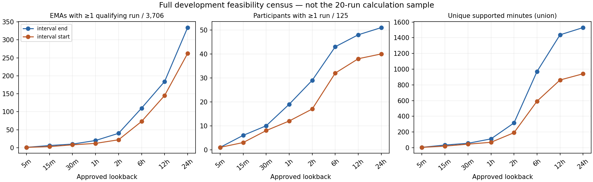
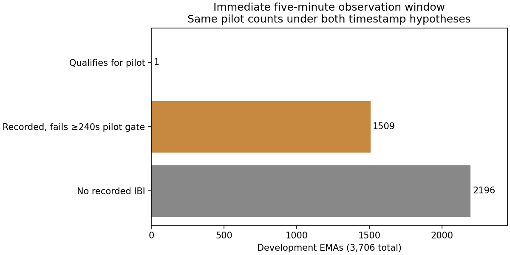

# Development IBI variability pilot

**IBI variability—normal-beat status unverified.** Calculations are limited to ten selected runs
per timestamp hypothesis, at most one per participant per hypothesis. These are ≥240-second
runs inside five-minute observation windows, not complete five-minute HRV recordings.
Only the five authorized time-domain outputs were retained. No outcomes or PSS were read.
All 32 final-test participants remain sealed; raw inputs, folds and prior bundles are unchanged.

## A cutoff-grid error corrected before any real calculation

The historical window generator multiplied a signed 16-bit step array by 60. At step 547,
the offsets wrapped, putting some nominally pre-EMA windows after the cutoff. The pilot's
cutoff invariant caught this before features. We corrected 3,294,634
of 5,321,816 stored window clocks in a **new** ignored Screen index and re-evaluated
the unchanged Screen policy at their correct locations. No sensor clocks were shifted.
The generating source now uses int64; a regression test covers both wrap points and 24 hours.
Historical 12/24-hour eligibility/continuity counts in Notebooks 01/02 must not be used;
this report supersedes them for the pilot census. Immediate through six-hour results are
unaffected. Reissuing the full three-policy long-lookback audit remains separate work.

## Selection and input conditions

[The protocol](../../ibi_pilot_protocol.md) fixed selection before calculation. Search all approved
5/15/30/60/120-minute and 6/12/24-hour lookbacks, with 300-second [start,end) windows at 60-second
steps. EMA UTC is local start minus its row's local-minus-UTC offset; Garmin Unix seconds get
no timezone shift. Cutoff is actual start minus 60 seconds for minute precision, actual start
for second precision. These cutoffs and the two interval-boundary hypotheses are unchanged.

Screen requires 250–2500 ms IBI, at least 80% interval/time agreement within max(0.25 s,25% of
expected interval), gap/expected ratio ≤2, each edge gap ≤5 s, ≥270 s supported union,
≥120 s contiguous timestamp span, flagged-change fraction ≤5%, and interval/elapsed ratio
0.8–1.2. Implausible intervals, repeated timestamps/conflicts and clock flags reject the window.
The >20% interval-change flag remains a provisional screen, not proof of an artifact.
For this pilot, one original run must additionally have **both span ≥240 s and supported union
≥240 s**. Each pair in that run passes the original adjacency and Screen timing checks.
Quality measures remain separate from predictors.

An interval is hypothesized as [t−IBI,t] for end, or [t,t+IBI] for start. Both timestamp
membership and whole-interval containment are required; crossing intervals remain in the
ignored member ledger as excluded, never trimmed into new intervals. Exact duplicate physical
records remain preserved upstream; the logical view collapses only exact duplicates. Repeated
interval values at different timestamps remain legitimate. Ties/conflicts are not averaged.
Rejected records, inconsistent pairs and recording gaps sever runs. Small timing residuals
within the frozen tolerance remain uncertainties, not a claim of continuous acquisition.

Exact repeated EMA views are deduplicated by source bounds. Views sharing any original IBI
record are also grouped transitively for conservative source-episode counting. No intervals
are merged: choose the earliest existing run in each component, then earliest per participant,
then earliest ten per hypothesis. Package acceptance and feature values cannot affect selection.
This chronological convenience sample is not representative of all development recordings.

## Full feasibility census, independent of the calculation sample

Every row below uses **3,706 EMAs and 125 development participants** as denominators, including
EMAs without Garmin or qualifying runs. Window instances are overlapping EMA views, not
independent observations. Unique supported minutes use interval unions within each participant;
they are not window counts multiplied by five. One segment within 24 hours is not day-long coverage.

| scenario | lookback_minutes | qualifying_ema | qualifying_participants | qualifying_window_instances | overlapping_source_episodes | unique_supported_minutes |
| --- | --- | --- | --- | --- | --- | --- |
| interval_end | 5 | 1 | 1 | 1 | 1 | 4.849 |
| interval_end | 15 | 6 | 6 | 11 | 7 | 34.123 |
| interval_end | 30 | 10 | 10 | 19 | 11 | 56.132 |
| interval_end | 60 | 20 | 19 | 41 | 22 | 112.426 |
| interval_end | 120 | 40 | 29 | 125 | 59 | 315.396 |
| interval_end | 360 | 110 | 43 | 494 | 174 | 969.866 |
| interval_end | 720 | 184 | 48 | 1120 | 251 | 1436.881 |
| interval_end | 1440 | 334 | 51 | 2447 | 268 | 1528.677 |
| interval_start | 5 | 1 | 1 | 1 | 1 | 4.848 |
| interval_start | 15 | 3 | 3 | 8 | 4 | 20.410 |
| interval_start | 30 | 8 | 8 | 16 | 9 | 45.449 |
| interval_start | 60 | 12 | 12 | 24 | 14 | 68.952 |
| interval_start | 120 | 22 | 17 | 71 | 37 | 191.102 |
| interval_start | 360 | 73 | 32 | 276 | 112 | 592.035 |
| interval_start | 720 | 145 | 38 | 634 | 162 | 861.798 |
| interval_start | 1440 | 262 | 40 | 1325 | 177 | 940.849 |

Across the 24-hour search there are 3,772 qualifying run views and
445 overlap components across the two hypotheses. Only 20 selected
run-hypothesis rows receive calculations. The samples share 8
participants, 4 overlapping source-run pairs and
1 identical source ranges; 1419
logical intervals overlap. Their hypothesized supported-time intersection is
14.775 minutes. The two samples must not be treated as independent.

### Why immediate availability is so small

Of 3,706 immediate windows, 2,196 contain no recorded IBI and 1,510 contain some IBI.
Only 4 end / 5 start windows pass the original Screen policy, which permits a two-minute run.
Adding this pilot's dual 240-second requirement leaves **one** per hypothesis; 1,509 recorded
windows fail the pilot conditions. This is sparse recording plus fragmentation, not evidence
that a single filter can recover a large immediate sample.

Notebook 02's unchanged immediate end-hypothesis diagnostics found overlapping losses from
short runs (1,469 recorded windows), internal gaps (1,409), insufficient support (926), edge
coverage (227), timing agreement (86), duration/elapsed mismatch (74), jump flags (23), ties
and conflicts (9 each), and clock flags (5). None failed interval plausibility. These counts
overlap and must not be added. Gap-only failures numbered 31 and run-only failures 21.
Removing the jump-flag check alone did not improve Screen retention. Six/seven-decimal timestamps
and compressed arrival clusters are inconsistent with treating all errors as whole-second
rounding. Batching remains possible; retention cannot establish acquisition versus receipt semantics.

## Selected-run duration and age

Values below are min/median/max across the ten selected runs per hypothesis, in seconds except
interval/pair counts. Age is relative to the earliest representative EMA cutoff after the chosen
observation window. Last-timestamp age and last-hypothesized-support age remain distinct. The
ignored exact-view ledger retains ages for every repeated EMA view of selected source bounds.
The full-census JSON also reports age ranges/medians across all qualifying, overlapping views.

| scenario | measure | count | minimum | median | maximum |
| --- | --- | --- | --- | --- | --- |
| interval_end | timestamp_span_seconds | 10 | 253.245 | 264.182 | 285.394 |
| interval_end | supported_seconds | 10 | 241.820 | 255.161 | 272.599 |
| interval_end | interval_count | 10 | 321.000 | 378.500 | 464.000 |
| interval_end | allowed_pair_count | 10 | 320.000 | 377.500 | 463.000 |
| interval_end | age_last_timestamp_seconds | 10 | 312.743 | 44280.437 | 63005.061 |
| interval_end | age_support_end_seconds | 10 | 312.743 | 44280.437 | 63005.061 |
| interval_start | timestamp_span_seconds | 10 | 250.933 | 259.070 | 272.584 |
| interval_start | supported_seconds | 10 | 241.151 | 250.402 | 264.087 |
| interval_start | interval_count | 10 | 307.000 | 361.500 | 445.000 |
| interval_start | allowed_pair_count | 10 | 306.000 | 360.500 | 444.000 |
| interval_start | age_last_timestamp_seconds | 10 | 323.874 | 40172.570 | 75361.266 |
| interval_start | age_support_end_seconds | 10 | 323.302 | 40171.875 | 75360.625 |

## What the five numbers measure

Mean IBI is average interval length; median IBI is the middle interval length. Sample SDNN
summarizes dispersion of interval values about their mean, using N−1. The conventional name
SDNN does not verify normal beats here. RMSSD is the square root of the average squared change
between original valid adjacent intervals. pNN50 is the percentage of those valid pairs whose
absolute change is **strictly greater than 50 ms**. For one accepted uninterrupted run P=N−1;
no differences are formed across removed records or run boundaries. Undefined values stay missing.

**Synthetic example, not participant data:** intervals [800,900,1000,950,850] ms have mean and
median 900 ms. Squared deviations sum to 25,000; sample SDNN = sqrt(25,000/4) = 79.05694 ms.
Original pair differences [100,100,−50,−100] ms give RMSSD = sqrt(32,500/4) = 90.13878 ms.
Three of four differences exceed 50 ms, so pNN50 = 75%; the exactly 50-ms pair does not count.
This five-interval example demonstrates arithmetic only, not the pilot duration criteria.

The following are aggregate ranges/medians of the **real selected-run** outputs. They are not
clinical reference ranges, stress associations, independent population estimates or EMA features.

| scenario | feature | count | minimum | median | maximum |
| --- | --- | --- | --- | --- | --- |
| interval_end | mean_ibi_ms | 10 | 612.586 | 741.495 | 821.358 |
| interval_end | median_ibi_ms | 10 | 610.000 | 740.000 | 818.000 |
| interval_end | sdnn_sample_ms | 10 | 14.176 | 26.628 | 43.717 |
| interval_end | rmssd_ms | 10 | 4.192 | 21.034 | 32.872 |
| interval_end | pnn50_pairs_percent | 10 | 0.000 | 0.988 | 12.632 |
| interval_start | mean_ibi_ms | 10 | 613.881 | 727.539 | 832.718 |
| interval_start | median_ibi_ms | 10 | 612.000 | 726.500 | 826.500 |
| interval_start | sdnn_sample_ms | 10 | 12.401 | 21.861 | 38.088 |
| interval_start | rmssd_ms | 10 | 4.196 | 18.016 | 32.789 |
| interval_start | pnn50_pairs_percent | 10 | 0.000 | 0.927 | 14.067 |

## Package agreement and blocked comparisons

Installed versions are NeuroKit2 0.2.13 and HeartPy 1.2.7, unchanged from Notebook 02; installed
source hashes and signatures match its recorded evidence. The old synthetic-only adapter stays
unchanged. The new guarded entrypoint uses its independent arithmetic and adjacency validator.

HeartPy's lower-level `calc_ts_measures` takes intervals and explicitly supplied adjacent
changes. We bypass waveform processing, RR cleaning, interpolation and high-level `process_rr`.
Convert its population SD by sqrt(N/(N−1)), and its pNN50 fraction to percent. It has no median
output, so median remains independently calculated. See the [official interface documentation](https://python-heart-rate-analysis-toolkit.readthedocs.io/en/latest/heartpy.analysis.html#heartpy.analysis.calc_ts_measures).

NeuroKit `hrv_time` accepts RRI in ms and actual `RRI_Time` in seconds, but its native pair
handling can differ from our input contract. Start anchoring is blocked; end anchoring requires
every actual pair within 10 ms of the current IBI, and sanitization must preserve both arrays.
No timestamps are changed to make it pass. Its native pNN50 denominator N would be converted
to P=N−1 when a call is allowed. See the [official HRV interface](https://neuropsychology.github.io/NeuroKit/functions/hrv.html#neurokit2.hrv.hrv_time).

| scenario | backend | compared | blocked | maximum_absolute_error |
| --- | --- | --- | --- | --- |
| interval_end | heartpy | 10 | 0 | 0.000 |
| interval_end | neurokit2 | 0 | 10 | None |
| interval_start | heartpy | 10 | 0 | 0.000 |
| interval_start | neurokit2 | 0 | 10 | None |

Agreement uses relative tolerance 1e−10 and absolute tolerance 1e−8. The package table records
blocked calls without invoking them; detailed reasons are in `package_summary.json` and the
ignored package ledger. Lower-level package internals compute some ancillary time-domain
quantities; only the five authorized outputs are retained, and spectral/nonlinear routines are
never called. Numerical agreement tests arithmetic, units and denominators, not physiology.

## Recommendation and unresolved questions

**Obtain specific provider clarification before expanding the IBI pilot as physiological HRV.**
Earlier runs make a small numerical pilot feasible: the corrected 24-hour census reaches
334 EMAs/51 participants under end and 262 EMAs/40 participants under start, versus one immediate
EMA each. That is about 9.0% / 7.1% of all EMAs, still selective and often hours away from the EMA.
This supports investigating earlier valid segments as a separate direction; it does not validate
24-hour coverage or associations with contemporaneous stress.

Ask the provider whether `ts` denotes acquisition or receipt, whether each IBI is start- or
end-anchored, whether export batching/resolution transforms timestamps, which modality/device
produced the intervals, whether units are confirmed milliseconds, how missed/duplicate beats
are represented, and whether normal-beat/artifact annotations exist. Until answered, retain
both hypotheses and the unverified-normal-beat label. No inference about these semantics is
made from package agreement or retention. A separately specified HR/activity feature effort
can proceed while these IBI questions remain unresolved; it is outside this checkpoint.

## Reproducibility and private artifacts

- Selection, corrected Screen index and all-EMA availability: `private/ibi_pilot/selection/52eb55d251e1d5e1/`.
- Run-level values: `private/ibi_pilot/calculation/59b11baba770afb0/run_level.parquet` (20 rows).
- All original selected-window members, including rejects: `private/ibi_pilot/calculation/59b11baba770afb0/selected_window_members.parquet`.
- Package checks: `private/ibi_pilot/calculation/59b11baba770afb0/package_comparisons.parquet` (40 rows).
- Source notebook: `notebooks/03_ibi_variability_pilot.ipynb`; executed copy stays in ignored `outputs/`.

Manifests hash inputs/code and refuse changed or incomplete prior versions. Selection was
published and its hash verified before features. The prior raw-preserving normalized data,
assignments, folds, frozen policies and original bundles remain intact. The verification report
alongside this version records tests, notebook execution, package checks, privacy and integrity.
The corrected Screen index intentionally does not repair historical three-policy reports.
No PSS targets, imputation, final feature linkage, EMA aggregation, models, commit or push occurred.
