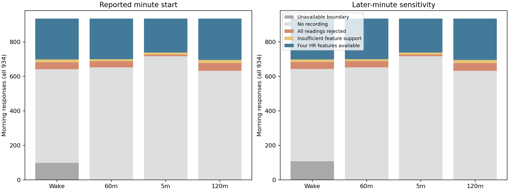
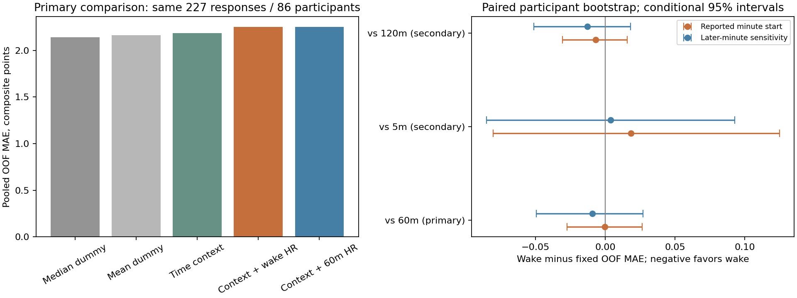
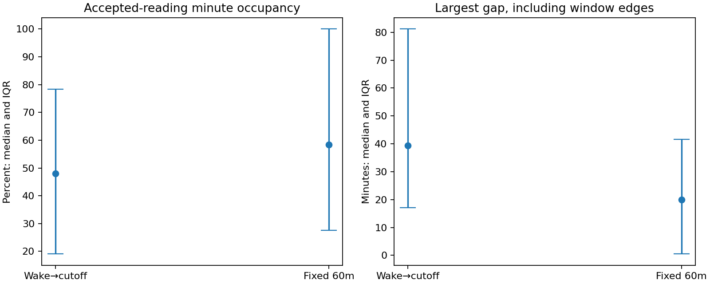
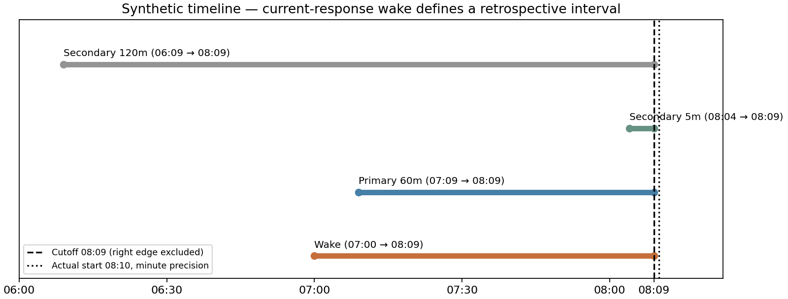

# Notebook 08 — retrospective Morning recall-window comparison

**Wake-to-cutoff HR did not show a useful predictive advantage over the specified fixed windows.**
In the primary matched cohort, nominal wake and 60-minute context+HR models have almost identical
OOF MAE (2.2506 vs 2.2510). Both have higher point-estimate error than matching median and context
baselines. This is a development-only, retrospective exploratory experiment; it does not validate
a deployable model, prove absence of physiological signal, or identify an optimal window.

## Specification and what enters the model

The [specification](../../morning_recall_specification.md) was frozen before new performance:
primary wake versus 60 minutes; secondary wake versus 5 and 120 minutes. Both documented wake
scenarios are separate. [Notebook 07's local questionnaire citations](../../recall_alignment/824551e40b8e301d/questionnaire_evidence.md)
establish Morning's **since waking up** wording. The current-survey wake answer defines only the
retrospective left boundary. It is never a predictor or information assumed known before the response.

Reuse the unchanged continuous three-item composite, actual-start cutoff and precision buffer,
HR acceptance and four features: observed-reading mean, sample SD (N−1), latest and elapsed-minute
OLS slope. Mean/SD need ≥2 distinct accepted timestamps spanning ≥1 second; latest needs one;
slope needs ≥3 spanning ≥60 seconds. Accepted HR retains the provisional 30–240 bpm range, clock
flags and entire conflict-group rejection; identical timestamp/value groups count once. No filled
values, extra readings or support relaxation. These are summaries of observed readings, not a
claim that a window was continuously measured.

All windows are [left,cutoff). Minute-resolution starts retain the 60-second buffer. Wake uses the
reported local date and EMA offset as already documented; no fabricated prior date or clock shift.
The later-minute sensitivity moves only the wake left boundary by 60 seconds; it is not a bound
on recall error. Same-day/offset and acquisition-versus-receipt semantics remain provisional.

Time context is sin/cos of actual local survey start. The existing category encoder sees only
Morning, so it adds no category contrast. All scalers/encoders fit on training folds only. Ridge
uses alpha=1, solver=svd, with intercept; its squared-error objective differs from MAE evaluation.
[Official Ridge](https://scikit-learn.org/stable/modules/generated/sklearn.linear_model.Ridge.html)
and [StandardScaler](https://scikit-learn.org/stable/modules/generated/sklearn.preprocessing.StandardScaler.html)
document the reused interfaces; the installed version is recorded in the private manifest.
No quantile regression, new alpha, HR-only model, quality predictor or current-answer predictor.

## Accounting: availability is part of the result

All **934 Morning responses / 125 development participants** are preserved per scenario: **931
valid scores and three missing**, without outcome imputation. Nominal wake has 836 positive
boundaries (three missing wake answers; 95 at/after cutoff). The later-minute scenario has 826;
10 further candidates become nonpositive. All these rows remain in accounting.

| scenario | interval | responses | boundary_unavailable | no_recording | all_readings_rejected | any_accepted_hr | insufficient_feature_support | complete_hr | complete_hr_participants |
| --- | --- | --- | --- | --- | --- | --- | --- | --- | --- |
| reported_minute_end_sensitivity | fixed_120 | 934 | 0 | 632 | 45 | 257 | 17 | 240 | 89 |
| reported_minute_end_sensitivity | fixed_5 | 934 | 0 | 716 | 10 | 208 | 12 | 196 | 75 |
| reported_minute_end_sensitivity | fixed_60 | 934 | 0 | 651 | 36 | 247 | 13 | 234 | 88 |
| reported_minute_end_sensitivity | wake | 934 | 108 | 534 | 40 | 252 | 15 | 237 | 87 |
| reported_minute_start | fixed_120 | 934 | 0 | 632 | 45 | 257 | 17 | 240 | 89 |
| reported_minute_start | fixed_5 | 934 | 0 | 716 | 10 | 208 | 12 | 196 | 75 |
| reported_minute_start | fixed_60 | 934 | 0 | 651 | 36 | 247 | 13 | 234 | 88 |
| reported_minute_start | wake | 934 | 98 | 543 | 40 | 253 | 16 | 237 | 87 |

Nominal wake's 253 responses with any accepted HR reduce to **237 with all four HR features / 87
participants**; 16 have insufficient feature support. Later-minute wake has 252 with any accepted
HR but the same 237 complete-feature responses. Feature-available rows happen to have complete
scores; the three missing scores remain in the excluded accounting. Reasons can overlap, and the
[exclusion combinations](exclusion_combinations.json) partition each comparison without double-counting.

## Matched cohorts and participant folds

Every model within a comparison is refit on the identical training response keys and evaluated on
the identical held-out keys. Mean/median dummies and context do not borrow a larger cohort.
The two scenarios happen to retain identical comparison memberships; their wake features can differ.
The all-window common cohort coincides with the 5-minute pairwise cohort; these are repeated views
of the same observations, not independent replications. The common cohort supplements the primary.

| scenario | cohort | responses | participants | excluded_responses | eligible_without_oof | limited_interpretation |
| --- | --- | --- | --- | --- | --- | --- |
| reported_minute_end_sensitivity | common | 191 | 74 | 743 | 0 | False |
| reported_minute_end_sensitivity | pair_fixed_120 | 233 | 87 | 701 | 0 | False |
| reported_minute_end_sensitivity | pair_fixed_5 | 191 | 74 | 743 | 0 | False |
| reported_minute_end_sensitivity | pair_fixed_60 | 227 | 86 | 707 | 0 | False |
| reported_minute_start | common | 191 | 74 | 743 | 0 | False |
| reported_minute_start | pair_fixed_120 | 233 | 87 | 701 | 0 | False |
| reported_minute_start | pair_fixed_5 | 191 | 74 | 743 | 0 | False |
| reported_minute_start | pair_fixed_60 | 227 | 86 | 707 | 0 | False |

Primary retention is **227/934 = 24.3% of Morning responses**, from 86 participants. The 5-minute
comparison/common cohort contains 191 responses / 74 people; the 120-minute comparison 233 / 87.
All original five folds are feasible and no folds are redrawn. The inherited flags (<100 responses,
<30 people or <5 validation people in any fold) do not trigger, but the cohorts remain modest and
selected. Never compare raw errors across these different pairwise populations as a window ranking.

| fold | training_responses | training_participants | validation_responses | validation_participants | excluded_validation_responses | status |
| --- | --- | --- | --- | --- | --- | --- |
| 0 | 175 | 66 | 52 | 20 | 136 | fitted |
| 1 | 173 | 68 | 54 | 18 | 139 | fitted |
| 2 | 191 | 73 | 36 | 13 | 146 | fitted |
| 3 | 186 | 69 | 41 | 17 | 146 | fitted |
| 4 | 183 | 68 | 44 | 18 | 140 | fitted |

| group | responses | participants | valid_scores | missing_scores | mean | median | q25 | q75 |
| --- | --- | --- | --- | --- | --- | --- | --- | --- |
| included | 227 | 86 | 227 | 0 | 6.4493 | 6 | 4 | 8 |
| excluded | 707 | 125 | 704 | 3 | 6.7230 | 7 | 5 | 9 |

Included primary responses have mean score 6.449 (median 6), versus 6.723 (median 7) among the 704
scored excluded responses. This is descriptive selection, not a basis to change support rules.
Participants can have both included and excluded responses; their counts cannot be added.
[All included/excluded distributions](included_excluded_scores.md), [score frequencies](score_distribution.json)
and [all fold counts](all_fold_counts.md) cover both scenarios and all comparisons.

## Primary performance and uncertainty

MAE is primary; RMSE secondary. Equal-participant MAE averages each person's mean absolute error.
Equal-participant RMSE averages each person's within-person RMSE, rather than taking the pooled root.
All values below are fixed OOF predictions on the **same 227 responses**.

| model | responses | participants | mae | rmse | participant_mae | participant_rmse |
| --- | --- | --- | --- | --- | --- | --- |
| mean | 227 | 86 | 2.1648 | 2.5564 | 2.2518 | 2.4084 |
| median | 227 | 86 | 2.1410 | 2.5945 | 2.2473 | 2.4261 |
| context | 227 | 86 | 2.1858 | 2.6044 | 2.2726 | 2.4437 |
| wake | 227 | 86 | 2.2506 | 2.8511 | 2.3810 | 2.5883 |
| fixed_60 | 227 | 86 | 2.2510 | 2.8445 | 2.3862 | 2.5965 |

Nominal wake minus 60-minute MAE is **−0.0003 points (95% interval −0.0275 to +0.0263)**;
the equal-participant MAE difference is −0.0053 (−0.0407 to +0.0274). Wake versus median dummy
is +0.1097 (−0.0531 to +0.3042), and wake versus context is +0.0649 (−0.0514 to +0.2359).
Point estimates provide no wearable gain beyond those baselines; uncertainty does not establish
harm or equivalence. The later-minute primary difference is −0.0093 (−0.0495 to +0.0270), with
unchanged membership. This sensitivity does not change the practical conclusion.

| scenario | cohort | baseline | responses | participants | mae_difference | mae_difference_low | mae_difference_high | participant_mae_difference |
| --- | --- | --- | --- | --- | --- | --- | --- | --- |
| reported_minute_end_sensitivity | common | fixed_60 | 191 | 74 | -0.0340 | -0.1068 | 0.0211 | -0.0608 |
| reported_minute_end_sensitivity | common | fixed_5 | 191 | 74 | 0.0038 | -0.0852 | 0.0927 | 0.0286 |
| reported_minute_end_sensitivity | common | fixed_120 | 191 | 74 | -0.0419 | -0.1070 | 0.0061 | -0.0660 |
| reported_minute_end_sensitivity | pair_fixed_120 | fixed_120 | 233 | 87 | -0.0129 | -0.0514 | 0.0181 | -0.0193 |
| reported_minute_end_sensitivity | pair_fixed_5 | fixed_5 | 191 | 74 | 0.0038 | -0.0852 | 0.0927 | 0.0286 |
| reported_minute_end_sensitivity | pair_fixed_60 | fixed_60 | 227 | 86 | -0.0093 | -0.0495 | 0.0270 | -0.0192 |
| reported_minute_start | common | fixed_60 | 191 | 74 | -0.0195 | -0.0582 | 0.0180 | -0.0362 |
| reported_minute_start | common | fixed_5 | 191 | 74 | 0.0183 | -0.0804 | 0.1248 | 0.0532 |
| reported_minute_start | common | fixed_120 | 191 | 74 | -0.0275 | -0.0600 | 0.0013 | -0.0415 |
| reported_minute_start | pair_fixed_120 | fixed_120 | 233 | 87 | -0.0068 | -0.0308 | 0.0156 | -0.0110 |
| reported_minute_start | pair_fixed_5 | fixed_5 | 191 | 74 | 0.0183 | -0.0804 | 0.1248 | 0.0532 |
| reported_minute_start | pair_fixed_60 | fixed_60 | 227 | 86 | -0.0003 | -0.0275 | 0.0263 | -0.0053 |

All direct wake-versus-fixed intervals include zero. Nominal pairwise differences for secondary
5 and 120 minutes are +0.0183 and −0.0068 points respectively. The common-cohort results also fail
to establish a wake advantage. These modest differences do not justify selecting a window or
searching more thresholds. See [all pooled results](pooled_metrics.md), [fold-level errors](fold_metrics.md),
[primary baseline contrasts](primary_baseline_differences.md) and [all paired intervals](paired_intervals.json).

Intervals use 2,000 paired participant-cluster bootstrap draws, seed 20261002, keeping all fixed
predictions for each sampled person together. They condition on this exploratory workflow, its
selected cohorts and fixed development fits. They do not include refitting/model-selection
uncertainty, correct for multiple comparisons, establish external validity, or treat overlapping
EMAs as independent. No winner, significance claim or deployable model is declared.

## Why timing alignment alone may be insufficient

On the primary included cohort, median wake duration is **115 minutes**, but median occupied-minute
fraction is only **48.1%**, versus **58.3%** for 60-minute windows. Median largest gap including edges
is **39.4 versus 20.0 minutes**; median internal gaps are 22.1 versus 17.1 seconds. Both windows have
median latest-reading age about 0.93 seconds, which does not erase long earlier/edge gaps. Median
left-edge gaps are 35.5 versus 7.7 minutes. Three readings and a long span do not establish coverage.
Quality is descriptive only; none of these quantities, wake duration or missingness is a predictor.
[Quality distributions](quality_diagnostics.json) include both scenarios, included/excluded groups,
all windows, quartiles and nonmissing denominators.

## Synthetic teaching example — no participant records

A minute-resolution survey starts at 08:10 and reports waking at 07:00. Cutoff is 08:09. Wake
uses [07:00,08:09); 60m uses [07:09,08:09); 5m uses [08:04,08:09); 120m uses [06:09,08:09).
With offset −240 minutes, add four hours to express these clocks in UTC. A 120-minute window can
include pre-wake data. The later-minute wake sensitivity starts at 07:01. A reading at 08:09 is
excluded. The current wake answer remains retrospective in every case.

For synthetic accepted readings 60, 70 and 80 bpm at elapsed 0, 1 and 2 minutes, mean=70 bpm,
sample SD=10 bpm, latest=80 bpm and slope=10 bpm/minute. If only the last reading lies in another
window, latest exists but the other features do not; that EMA cannot enter that paired comparison.
An EMA with three valid stored items (4,2,3) has the existing composite 4+(6−2)+(6−3)=11. Its
held-out prediction must come from a model trained on other participants' folds, using the same
matched response cohort as every comparator. All teaching numbers are synthetic.

## Professor-facing conclusion and next justified work

The specified retrospective wake alignment does **not currently support a better HR baseline**.
A conceptual recall match did not translate into useful held-out error reduction, and HR models
remain worse by point estimate than matching simple baselines. This does not show that stress has
no physiological correlate; recording support, self-reported boundaries and event-clock semantics
still limit the measurement. Keep the common cohort and later-minute sensitivity as checks, not
independent confirmations or opportunities to select a favorable result.

Do not expand a window/alpha search on these results. The next justified work is measurement
clarification: obtain acquisition/receipt and batching definitions, confirm survey start and wake
report date/offset semantics, and determine whether available device-quality metadata can explain
recording gaps. A stronger measurement/coverage protocol would need a separate specification and
fresh evaluation; no data-provider message was sent and no further experiment was run here.

## Artifacts and safeguards

Private immutable bundle: `private/morning_recall/runs/4c844f737b74ee62`.
`features.parquet` and `accounting.parquet`: 1,868 rows each (934 × two scenarios).
`quality.parquet` and `membership.parquet`: 7,472 rows each. `out_of_fold_predictions.parquet`:
1,684 matched comparison views, not independent responses. `lineage.parquet` retains wake source
slices; `training_audit.json` retains matched key hashes, fitted scalers/encoders, coefficients and
matching dummy constants. Public artifacts contain only aggregate tables/figures and synthetic examples.
All 32 final-test participants remain sealed; prior outcomes/features, raw data, assignments, folds
and immutable bundles are preserved. No HRV, Garmin stress, imputation, quality predictor, binary
cutoff, nonlinear model, commit or push. See the separate checkpoint verification for executed checks.
