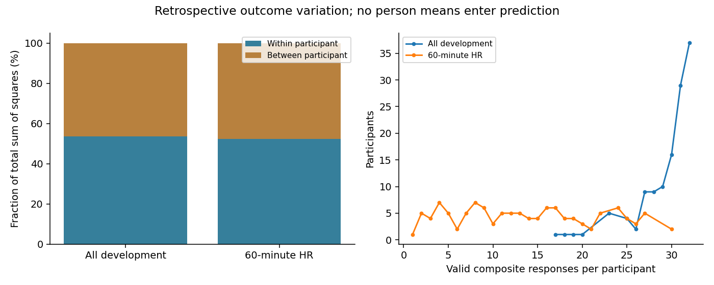
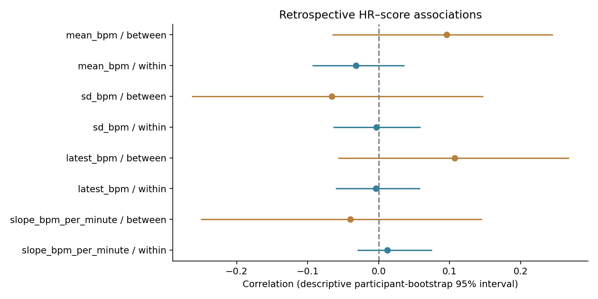
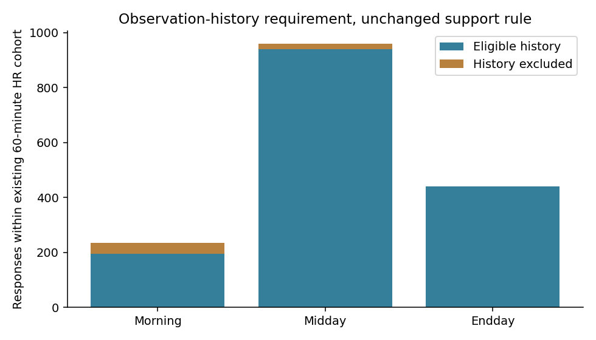
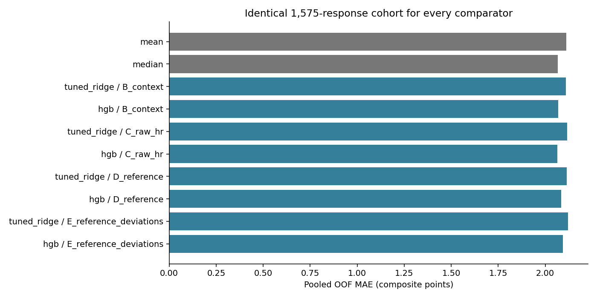
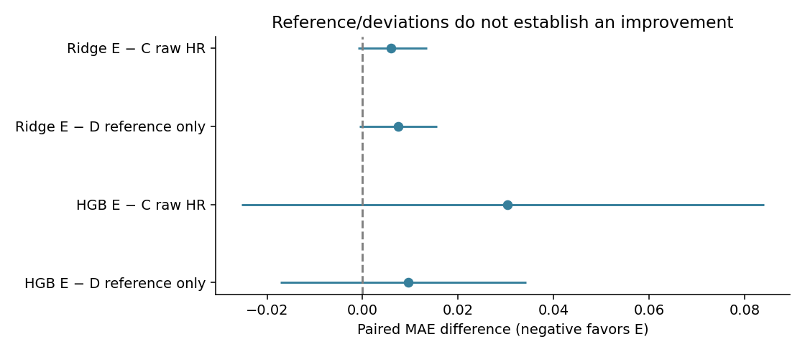

# Notebook 10 — within-person signal and earlier-recording HR reference

**The earlier-recording reference/deviation models do not improve on matched raw HR or
reference-only models in this bounded experiment.** Outcome variation is substantial both within
and between participants; that fact alone does not establish useful HR prediction. Timing remains
provisional. This estimates exploratory prediction after a wearable observation period, not validated
real-time prediction, resting HR or a complete daily baseline.

## Where variation occurs — retrospective only

All 3,706 development responses are retained; 3,689 have valid continuous composite scores. The
125 people have a median 31 valid responses (range 17–32). The existing 60-minute HR cohort has
1,634 responses / 118 people, median 13 (range 1–30); one person has a single response in that cohort.
No whole-record participant means, outcome histories or centered rows enter predictive features.

| at_least_two | count_kind | maximum | median | minimum | participants | q25 | q75 | responses | scope |
| --- | --- | --- | --- | --- | --- | --- | --- | --- | --- |
| 125 | all_responses | 32 | 31 | 17 | 125 | 29 | 32.0000 | 3706 | all_development |
| 125 | valid_composite | 32 | 31 | 17 | 125 | 28 | 32.0000 | 3689 | all_development |
| 117 | all_responses | 30 | 13 | 1 | 118 | 8 | 19.7500 | 1634 | native_60m_hr |
| 117 | valid_composite | 30 | 13 | 1 | 118 | 8 | 19.7500 | 1634 | native_60m_hr |

| scope | valid_responses | participants | within_ss_fraction | between_ss_fraction | pooled_within_sd | person_mean_sd | median_person_sd |
| --- | --- | --- | --- | --- | --- | --- | --- |
| all_development | 3689 | 125 | 0.5353 | 0.4647 | 2.0061 | 1.8487 | 1.8033 |
| native_60m_hr | 1634 | 118 | 0.5234 | 0.4766 | 1.9252 | 1.9406 | 1.7563 |

Across all development responses, **53.5%** of total squared variation is within participants and
**46.5%** is between their observed means, weighted by response count. On the native HR cohort the
fractions are **52.3% / 47.7%**. Within-person pooled SD is 2.006 and 1.925 composite points respectively.
This is an exact descriptive SS decomposition, **not** an estimated random-effects ICC, reliability
measure or causal explanation. Between-person means can reflect different survey/context sampling.
The decomposition and all item results are in [variation.md](variation.md).

## Three component items, unchanged composite

[Local questionnaire evidence](../../recall_alignment/824551e40b8e301d/questionnaire_evidence.md)
verifies stored codes 1–5 paired with displayed 0–4 anchors. `PSS_NERVOUS` asks stressed/nervous;
`PSS_COPE` asks able to handle/cope; `PSS_CONTROL` asks on top of things. Preserve
**nervous + (6−cope) + (6−control)**, require all three, range 3–15. No item or cutoff is selected
as a replacement outcome. It is the study's three-item perceived-stress composite, not a diagnostic.

All-development valid counts are 3,692 nervous, 3,690 cope, 3,689 control; stored means are
1.856, 3.824 and 3.625. Higher cope/control imply *lower* composite contributions after reversal.
Nervous has 74.7% within-person SS, cope 49.3%, control 49.8%. Each uses its own valid-item denominator;
these are not interchangeable alternative targets. [Component tables](component_items.md) include
all five code frequencies, missingness and survey-category summaries, repeated on the HR cohort.
Morning asks since waking; Midday/Endday since the last prompt. No missing prompt boundary is invented.

## Descriptive HR–score associations

Use the native 60-minute cohort: between-person correlations relate equally weighted full-record
participant means; within-person associations demean both HR and score within each person, weighting
responses and excluding the one singleton. All full-record means are retrospective and can use
future responses relative to an event. They are never exported to the predictive tables. Confidence
intervals resample whole participants, not independent rows; no causal or validated predictive claim.

| feature | mode | participants | correlation | correlation_low | correlation_high | slope | slope_low | slope_high |
| --- | --- | --- | --- | --- | --- | --- | --- | --- |
| hr_mean_bpm__60m | between_person_means | 118 | 0.0960 | -0.0654 | 0.2451 | 0.0227 | -0.0145 | 0.0597 |
| hr_mean_bpm__60m | within_person_centered | 117 | -0.0320 | -0.0937 | 0.0360 | -0.0065 | -0.0189 | 0.0075 |
| hr_sd_bpm__60m | between_person_means | 118 | -0.0661 | -0.2632 | 0.1472 | -0.0883 | -0.3540 | 0.2008 |
| hr_sd_bpm__60m | within_person_centered | 117 | -0.0033 | -0.0641 | 0.0587 | -0.0022 | -0.0414 | 0.0389 |
| hr_latest_bpm__60m | between_person_means | 118 | 0.1072 | -0.0575 | 0.2683 | 0.0229 | -0.0121 | 0.0576 |
| hr_latest_bpm__60m | within_person_centered | 117 | -0.0037 | -0.0608 | 0.0582 | -0.0006 | -0.0090 | 0.0088 |
| hr_slope_bpm_per_minute__60m | between_person_means | 118 | -0.0402 | -0.2504 | 0.1452 | -0.1123 | -0.8223 | 0.4132 |
| hr_slope_bpm_per_minute__60m | within_person_centered | 117 | 0.0123 | -0.0301 | 0.0749 | 0.0119 | -0.0299 | 0.0842 |

For HR mean, between-person r=.096 [−.065,.245]; within-person r=−.032 [−.094,.036]. Other centered
correlations are similarly small in this diagnostic; all displayed association intervals include zero.
This neither proves an absence of physiological relationships nor motivates a replacement target.

## Earlier-recording reference and available history

The [specification](../../past_hr_reference_specification.md) was frozen before new prediction results.
For each existing cutoff, keep current **[cutoff−1 hour, cutoff)** and use reference
**[cutoff−25 hours, cutoff−1 hour)**. The history is exactly 24 hours and cannot borrow a current-window
or future reading. Existing precision buffers and HR acceptance remain unchanged. First clip accepted
readings to the exact interval, then average within **observed UTC minutes**, then average those
minute means equally. Empty minutes are missing; boundary minutes can be partial. Same-value timestamp
ties/conflicts follow the original disposition ledger. Repeated equal values at different times remain.

Require **30 occupied UTC minutes AND 3 distinct UTC-hour bins**. This fixed engineering rule is
provisional, not a physiological standard. It does not establish complete coverage or resting HR.
Reference age is derived from actual observed timestamps; quality includes first/latest/equal-minute
mean observation age, span, internal/edge gaps and occupied bins, excluded from predictors.
Current HR mean is reading-weighted, whereas reference mean is minute-weighted: deviations combine
those two summaries, not a pure isolated physiological change. No EMA answers or whole-person
normalization are used. Held-out participants contribute only their own earlier unlabeled HR.

Reference history passes for **3,059/3,706 responses** independent of current HR/outcome availability.
Intersecting with the native HR cohort retains **1,575/1,634 (96.4%) / 116 participants**; 59 responses
are excluded. This is 42.5% of all development responses; most overall loss predates the history rule.
All five original outer folds remain feasible, with 268–364 validation responses and 22–25 people.

| group | survey_category | responses | participants | score_mean | score_median |
| --- | --- | --- | --- | --- | --- |
| eligible | All | 1575 | 116 | 6.2908 | 6.0000 |
| eligible | Endday | 440 | 104 | 6.2045 | 6.0000 |
| eligible | Midday | 940 | 115 | 6.3128 | 6.0000 |
| eligible | Morning | 195 | 77 | 6.3795 | 6.0000 |
| excluded | All | 59 | 51 | 6.6780 | 7.0000 |
| excluded | Endday | 1 | 1 | — | — |
| excluded | Midday | 19 | 17 | 5.8947 | 6.0000 |
| excluded | Morning | 39 | 37 | 6.9487 | 7.0000 |

Included scores average 6.291; the 59 history-excluded native responses average 6.678. They represent
51 people, many also contributing eligible responses; participant counts cannot be added. Among all
2,131 excluded development responses, 2,114 have scores (mean 6.493), 17 remain missing. Small-cell
outcome/quality summaries are suppressed publicly, with counts retained; private accounting stays complete.

Of the 59 native exclusions: six have no recording; 15 have recorded but entirely rejected readings;
23 have some accepted readings but fail both minute/hour rules; seven fail only the minute rule;
eight fail only the hour rule. The overlapping totals are 51 failing minutes and 52 failing hours;
these cannot be summed. [Attrition](attrition.md) retains both exclusive combinations and overlaps.

Eligible reference histories have median **572 occupied minutes / 12 occupied UTC-hour bins**.
Median latest-reading age is **3,600.935 seconds**, just beyond the excluded current hour. But the
median largest gap including edges is **41,247 seconds (11.46 hours)**; median internal maximum gap
is 37,855 seconds. A recent endpoint does not fill the preceding long gap. Counts of occupied bins
are recording diagnostics, not observed continuous physiological duration. See [reference_quality.md](reference_quality.md).

## Matched A–E comparisons

A: mean/median dummies. B: actual-start cyclic time + survey category. C: B + current raw HR
mean/SD/latest/slope. D: B + earlier reference mean. E: B + reference mean + current mean/latest
minus reference + current SD/slope. Every model uses exactly the same eligible training and validation
responses in unchanged outer participant folds. No answer, participant ID, quality/missingness,
Garmin stress, new activity, imputation or HRV enters X.

For B–E, reuse Notebook 09's Ridge [.1,1,10,100] and HGB depth [1,2] × iterations [50,150] grids.
HGB absolute-error loss, learning_rate=.05, min_samples_leaf=20, L2=1, early_stopping=False are fixed.
Three participant-grouped inner folds inside each outer training set select mean inner MAE; training
splits fit their own scaler/encoder. Outer validation outcomes never tune settings. No row-random
holdout or clipping. Ridge/HGB differ in loss and regularization as well as function class.

| model | responses | participants | mae | rmse | participant_mae | prediction_sd |
| --- | --- | --- | --- | --- | --- | --- |
| mean | 1575 | 116 | 2.1111 | 2.5622 | 2.2343 | 0.0417 |
| median | 1575 | 116 | 2.0673 | 2.5758 | 2.1911 | 0.0000 |
| tuned_ridge__B_context | 1575 | 116 | 2.1110 | 2.5634 | 2.2373 | 0.0872 |
| hgb__B_context | 1575 | 116 | 2.0694 | 2.5794 | 2.1926 | 0.1299 |
| tuned_ridge__C_raw_hr | 1575 | 116 | 2.1158 | 2.5682 | 2.2444 | 0.1738 |
| hgb__C_raw_hr | 1575 | 116 | 2.0646 | 2.5881 | 2.1804 | 0.2468 |
| tuned_ridge__D_reference | 1575 | 116 | 2.1144 | 2.5717 | 2.2423 | 0.1436 |
| hgb__D_reference | 1575 | 116 | 2.0854 | 2.6429 | 2.2113 | 0.3624 |
| tuned_ridge__E_reference_deviations | 1575 | 116 | 2.1218 | 2.5779 | 2.2522 | 0.1941 |
| hgb__E_reference_deviations | 1575 | 116 | 2.0949 | 2.6809 | 2.2213 | 0.4351 |

HGB E MAE **2.0949** versus C **2.0646**, D **2.0854**, B **2.0694**, and median **2.0673**.
E−C is **+.0303 [−.0253,+.0840]**; E−D **+.0095 [−.0172,+.0343]**. Ridge E MAE **2.1218** versus
C **2.1158**, D **2.1144**: E−C **+.0060 [−.0010,+.0135]**, E−D **+.0074 [−.0007,+.0155]**.
These reference/deviation representations do not establish gain. D−B tests reference levels alone;
E−D tests added current HR conditional on that reference; E−C tests the reference/reparameterized
representation versus raw HR. Differences and coefficients are not causal; Ridge's penalty geometry
also changes under reparameterization.

HGB raw-HR C is .0027 points below median, but its interval [−.0179,+.0115] includes zero; versus
HGB context the change is −.0048 [−.0214,+.0111]. This small conditional result does not justify a
winning model or further searching. Ridge E is worse than median by .0545 [.0154,.0912] on pooled
MAE; some participant-MAE contrasts also exclude zero on the worse-error side. Report the full
[paired differences](paired_intervals.md), not just favorable comparisons.

All 480 inner and 40 outer learned fits complete; matching dummies add ten outer predictions.
All Ridge selections are alpha=100. HGB settings vary by fold; selected configurations, prediction
ranges/SD/distinct counts and training/validation MAE are in [selected_settings.md](selected_settings.md).
[Metrics](metrics.md) retain pooled, fold and survey MAE/RMSE/equal-participant MAE and variation.
Training metrics count repeated outer-training memberships, not independent extra observations.
The [fold table](fold_counts.md) records exact cohort sizes. No support/fold rule was relaxed.

Intervals use 2,000 paired participant-cluster resamples of fixed OOF predictions, not independent
responses. They omit refitting/tuning uncertainty, multiplicity adjustment and external validation.
Nested tuning does not erase repeated development exploration. No optimal window or model is declared.

## Synthetic teaching example and feature status

Suppose current cutoff is Tuesday 12:00 UTC. Current window is Tuesday 11:00–12:00; history is
Monday 11:00–Tuesday 11:00, right-exclusive. A reading exactly Tuesday 11:00 is excluded from
reference and can enter current HR. Suppose 30 accepted minute means span three UTC hours: ten
minutes average 60, ten 70, ten 80. Reference is 70 regardless of reading density within minutes.
If current mean=85 and latest=90, deviations are +15 and +20 bpm. Those values are synthetic;
empty minutes stay missing, and no inference of resting physiology follows.

[Feature-status table](feature_status.md) distinguishes implemented/evaluated features, untested
candidates and measurement-blocked concepts. Historical personalization Markdown in the legacy
`notebooks/v2_raw/14_v2_feature_blocks_and_baselines.ipynb` and `15_v2_data_walkthrough_and_descriptives.ipynb`
used prior nonoverlapping EMA-associated wearable windows. That documentation was consulted only
as conceptual background; no obsolete feature/results were imported as evidence or run.

## Recommendation and outstanding provider evidence

**Stop automatic model expansion for this experiment.** History availability is adequate under the
fixed provisional rule, but it is discontinuous and the new representation does not improve matched
prediction. Seek acquisition/receipt and batching semantics, actual prompt logs, sensor-quality flags
and IBI anchoring/missed-beat definitions before proposing another measurement-valid experiment.
The [provider request](provider_request_draft.md) is a local draft only and has not been sent.

Verified facts are numerical consistency, cohort membership and the stated observed results.
Provisional assumptions are timestamp availability, HR acceptance, reference support and meaning.
Only provider evidence can establish acquisition/receipt semantics and missing quality metadata.
Neither outcome decomposition nor retrospective associations demonstrate deployability or absence
of true physiological signal. No expanded HRV, stress, imputation, binary cutoff or final-test evaluation.

## Outputs and verification

Private immutable bundle: `private/past_hr_reference/runs/510f1ad96a9e46f3`. All 3,706 rows remain in `reference_features.parquet`,
`reference_quality.parquet`, `reference_lineage.parquet`, `predictive_inputs.parquet` and `accounting.parquet`.
`out_of_fold_predictions.parquet` has 1,575 response rows; `training_predictions.parquet` has 6,300
repeated training memberships. All are ignored. No row-level full-person means are persisted.
Notebook: `notebooks/10_within_person_signal_and_past_hr_reference.ipynb`.
Preserve raw sources, prior immutable outputs and frozen assignments. No commit, push or provider messages.
