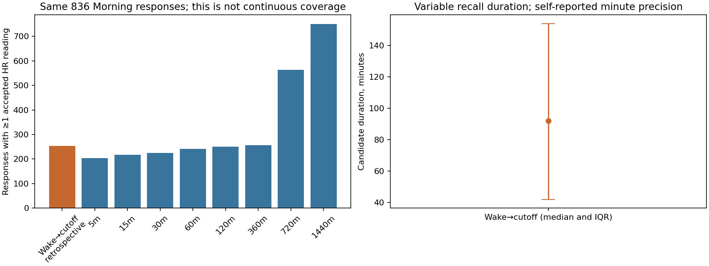
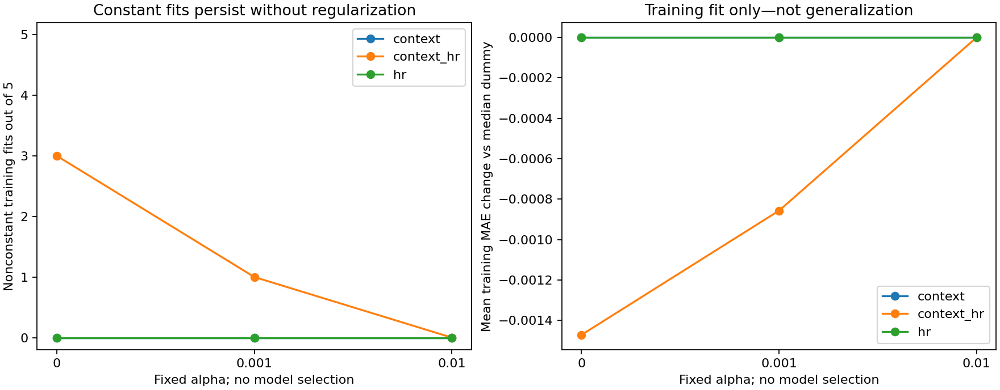

# Notebook 07 — recall alignment and median-regression diagnostics

**The questionnaire recall periods differ from fixed pre-EMA windows. Available data support only
retrospective Morning wake-to-cutoff candidates. Removing regularization does not, by itself,
resolve constant HR-only median predictions.** No new validation scores or predictions were made.
This exploratory diagnostic follows inspection of Notebooks 05–06. Its [specification](../../recall_alignment_specification.md)
and three alphas were frozen before the new fits and coverage comparisons.

## What the questionnaires actually ask

[Exact item wording, question/page numbers and local PDF citations](questionnaire_evidence.md)
show that all three composite items refer to **since waking up** in Morning, and **since the last
prompt** in both Midday and Endday. They ask about feeling stressed/nervous, being able to cope,
and being on top of things. Endday does not establish a whole-day recall period. The current
continuous composite and stored 1–5 coding are unchanged; no new target calculation was needed.

## Which clocks are available

| Clock or field | Evidence and limitation | Prediction-time status |
| --- | --- | --- |
| `actual_start_local` | Observed export field, present on all 3,706 development responses; exact app event needs provider confirmation | Used by existing analysis cutoff; retrospective export does not itself prove live availability |
| `timezone_offset` | Observed local-minus-UTC offset on every row | Used to derive UTC at actual start |
| `scheduled_start_local`, `instance_id` | Present on every response; no scheduled/instance discrepancy or actual-before-scheduled flags; instance corresponds to scheduled Unix time | Current scheduled instance is not a log of prior delivered prompts |
| `SLEEP_WAKETIME` | Morning answer to final waking today; 931/934 nonmissing, minute precision | Learned from current response: retrospective-only |
| `SLEEP_SLEEPTIME` | Current Morning self-report, 931/934 nonmissing | Not an observed wake event or a pre-response boundary |
| Notification, delivery, complete scheduled-prompt history | No dedicated log or corresponding timestamp fields supplied | Unavailable; need all prompts, including unanswered/expired/suppressed ones |
| Submission/completion time | No explicit timestamp supplied; completion/reminder flags are answers/instructions | Unavailable; a completion flag is not an event clock |
| `Location Timestamp` | Optional context sample timestamp; semantics need confirmation | Cannot substitute for a prompt, wake or submission event |
| Garmin `ts`, `dte_tme` | Original sensor clocks preserved; Unix `ts` gets no extra timezone shift | Acquisition versus receipt/batching remains unresolved |
| UTC actual start and cutoff | Derived from observed start/row offset; minute starts buffered by 60 seconds, second starts unbuffered | Same frozen cutoff policy as previous notebooks |

The structural audit inspected three EMA headers, 154 sensor headers, six blank PDFs and all
supplied archive member types. No final-test response or sensor values were explored. Absence
means absent from the supplied corrected sources, not necessarily absent from the provider's
system. [Field counts and source inventory](source_evidence.json) retain schema-level evidence.
Previous completed surveys cannot substitute for previous prompts, and a first wearable reading
cannot establish waking. No clock was shifted to improve alignment.

## Retrospective feasibility, not a deployable boundary

The wake question says **today** and **final waking**. The nominal candidate places its reported
HH:MM on the actual-start local date and applies that EMA's offset. Same-day interpretation and
unchanged UTC offset since waking are provisional; cross-midnight answering, DST/travel and
respondent interpretation cannot be verified. There is no previous-day repair. Each candidate
ends at the existing cutoff, excluding readings at the right edge. The buffer can omit part of
the item’s recalled period. The reported minute start and +60-second limiting sensitivity are
kept separate; neither supplies a measured second of waking.

| scenario | survey_category | reason | responses | participants |
| --- | --- | --- | --- | --- |
| reported_minute_end_sensitivity | Endday | previous_prompt_log_unavailable | 934 | 124 |
| reported_minute_end_sensitivity | Midday | previous_prompt_log_unavailable | 1838 | 125 |
| reported_minute_end_sensitivity | Morning | candidate | 826 | 125 |
| reported_minute_end_sensitivity | Morning | minute_uncertainty_reaches_cutoff | 10 | 9 |
| reported_minute_end_sensitivity | Morning | missing_wake_response | 3 | 3 |
| reported_minute_end_sensitivity | Morning | wake_not_before_cutoff | 95 | 55 |
| reported_minute_start | Endday | previous_prompt_log_unavailable | 934 | 124 |
| reported_minute_start | Midday | previous_prompt_log_unavailable | 1838 | 125 |
| reported_minute_start | Morning | candidate | 836 | 125 |
| reported_minute_start | Morning | missing_wake_response | 3 | 3 |
| reported_minute_start | Morning | wake_not_before_cutoff | 95 | 55 |

Nominally **836/934 Morning responses across all 125 development participants** have positive
candidates. Three lack a wake answer; 95 have a nominal wake at/after cutoff: 53
after actual start, 31 equal to actual start, and 11
in the buffered interval before actual start. These are temporal inconsistencies or buffer exclusions,
not repaired clocks or proof of dishonest responses. Moving to the later minute boundary excludes
10 more, leaving 826. **Zero boundaries are established as available before the current response.**
All 1,838 Midday and 934 Endday rows remain accounted for with unavailable previous-prompt boundaries.
Participant counts across reasons overlap and should not be added.

Nominal candidate duration is **92 minutes** (IQR
42–154; range
1.0–659.0).
Only **253 candidates / 91 participants** have any accepted HR: **543 have no recorded HR** and
**40 have recordings but all are rejected** under unchanged clock/value/conflict rules. The later
minute sensitivity has 252 with accepted HR, 534 no-recording and 40 all-rejected cases.
Across all nominal candidates, median occupied-bin fraction is zero. Conditional on any accepted
HR it is 41.4%, with median largest edge-inclusive gap
44.2 minutes. A recent final reading does not erase earlier gaps.

Bins are anchored at each left boundary, with a partial last minute counted in the ceil(duration/60)
denominator. Occupancy is not supported physiological duration. HR acceptance retains 30–240 bpm,
existing clock flags and timestamp-conflict rejection; identical timestamp/value duplicates contribute
one reading, legitimate readings at different times remain. No interpolation, carry-forward or new
support threshold. Counts are response views of recordings; overlapping windows are not independent.

### Fixed windows on exactly the same nominal candidate responses

| lookback_minutes | responses | with_accepted_hr | participants_with_accepted_hr | occupied_bin_fraction_median |
| --- | --- | --- | --- | --- |
| 5 | 836 | 204 | 78 | 0.0000 |
| 15 | 836 | 217 | 83 | 0.0000 |
| 30 | 836 | 225 | 86 | 0.0000 |
| 60 | 836 | 241 | 89 | 0.0000 |
| 120 | 836 | 250 | 91 | 0.0000 |
| 360 | 836 | 257 | 92 | 0.0000 |
| 720 | 836 | 563 | 119 | 0.0160 |
| 1440 | 836 | 750 | 122 | 0.1972 |

Longer windows find more readings partly because they extend before the reported awakening; this
is not evidence that they match Morning recall better. Both wake scenarios have separately matched
eight-lookback tables, paired availability counts and fold representation in the JSON tables. Responses
without HR remain in every denominator. No boundary/coverage rule was chosen from performance.

## Why median regression can stay constant

The saved five-minute Policy A cohort is unchanged: **1,395 responses / 117 participants**. All 15
saved alpha=.01 context/HR/context+HR fold fits have effectively zero slopes and predictions of 6.
Their coefficients, training means/scales, category encoders and objectives reproduce in this checkpoint;
saved prediction columns were inspected without reading their validation outcomes.

Each new fit uses only four original participant folds: 1,065/1,089/1,125/1,124/1,177 training responses.
Training-only scaling is correct and HR inputs vary. No quality columns, current answers, IDs, activity,
or nonapproved lookbacks enter the models. Targets for the held-out fold are excluded at the Parquet
read before fitting. Each fold serves as training in other rotations, as in the original grouped design.

The median objective is mean pinball loss plus L1 penalty: **0.5 × training MAE + alpha × sum of
absolute coefficients**, excluding the intercept. Alpha=0 removes that penalty. Numeric predictors
are standardized using training population variance; survey categories are encoded on training only.
Full category encoding with an intercept creates expected rank redundancy: coefficient allocation
need not be unique. Coefficient magnitudes are not physiological or causal effects.
[Official QuantileRegressor documentation](https://scikit-learn.org/stable/modules/generated/sklearn.linear_model.QuantileRegressor.html)
and the [linear-model objective](https://scikit-learn.org/stable/modules/linear_model.html#quantile-regression)
support this calculation; installed package versions are recorded in the private manifest.

| model | alpha | fits | nonconstant_training_fits | mean_training_mae_change | largest_training_mae_reduction | max_training_prediction_sd | maximum_nonzero_coefficients |
| --- | --- | --- | --- | --- | --- | --- | --- |
| context | 0.0000 | 5 | 0 | 0.0000 | 0.0000 | 0.0000 | 0 |
| context | 0.0010 | 5 | 0 | 0.0000 | 0.0000 | 0.0000 | 0 |
| context | 0.0100 | 5 | 0 | 0.0000 | 0.0000 | 0.0000 | 0 |
| context_hr | 0.0000 | 5 | 3 | -0.0015 | -0.0044 | 0.3040 | 8 |
| context_hr | 0.0010 | 5 | 1 | -0.0009 | -0.0043 | 0.2944 | 8 |
| context_hr | 0.0100 | 5 | 0 | 0.0000 | 0.0000 | 0.0000 | 0 |
| hr | 0.0000 | 5 | 0 | 0.0000 | 0.0000 | 0.0000 | 0 |
| hr | 0.0010 | 5 | 0 | 0.0000 | 0.0000 | 0.0000 | 0 |
| hr | 0.0100 | 5 | 0 | 0.0000 | 0.0000 | 0.0000 | 0 |

All **45 fits converged**, with no convergence warnings. HR-only and context-only predictions stay
constant in all five folds even at alpha=0. Context+HR at alpha=0 varies in three folds, with training
MAE reductions of approximately **0.0008, 0.0044 and 0.0021 composite points**. At alpha=.001 only one
fold varies; alpha=.01 returns the constant in all five. Median=6 is a strong training solution under
the absolute-error objective; 11.2%–13.6% of each training set lies exactly at 6. The nonsmooth median
loss can have a constant optimum even when predictors vary. This is consistent with weak incremental
linear median information in these training sets, not proof of no wearable signal or of a unique optimum.
Penalty removal alone is therefore an inadequate explanation for HR-only collapse.

[All fold diagnostics](training_fold_diagnostics.md) include rank, sparsity, training loss/penalty,
median mass and prediction variation. Negative loss changes are in-sample only. No new validation
prediction, validation loss, confidence interval, winning alpha or optimal recall window is declared.
Regularization strengths are not directly comparable between Ridge and quantile regression.

## Synthetic explanation (not participant data)

Suppose a Morning response starts at 08:10 with minute precision, offset −240 minutes, and reports
waking at 07:00. The cutoff is 08:09 local / 12:09 UTC; the nominal retrospective interval is
[11:00,12:09) UTC. The later-minute sensitivity starts at 11:01. Neither uses the 08:10 response
answer as information that was known at 08:09. Readings at cutoff are excluded. If only 20 of its
69 bins contain HR, occupancy is 20/69, not 20 minutes of continuously observed physiology.

For synthetic training scores [4,6,6,8], constant 6 has MAE 1 and pinball loss .5. A fitted model
with training MAE .98 and coefficient L1 norm 2 has objective .49 at alpha=0 but .51 at alpha=.01;
the median constant remains feasible at .5. Removing a penalty permits variation, but cannot create
a relationship that the training data do not support. These numbers are teaching examples only.

## What is resolved and what to do next

**Verified:** survey-specific wording; absence of a supplied complete prompt log; current-response
wake field; candidate coverage and attrition; correct scaling/objective replay; persistent unpenalized
HR-only constant fits. **Provisional:** reported-day/offset interpretation, minute anchoring, device
validity rules and timestamp semantics. **Unknown:** actual delivery history and what participants
understood by last prompt, exact event clocks, and real-time availability.

Request provider clarification before treating recall alignment as a prediction-time feature design.
A testable next experiment is a separately frozen, explicitly retrospective Morning-only comparison
of wake-to-cutoff and fixed windows on identical response/fold cohorts, after reviewing accepted HR
support and preserving missingness. Do not pool it with since-last-prompt outcomes or call it real-time
prediction. The current 253 responses with any HR are an upper bound before requiring all four HR
features/support, not a promised model sample. Further alpha searching is not justified by these
training-only gains. A future validation experiment would require a new specification; none was run.

Provider-only questions (draft, not sent):

1. Supply full scheduled, delivered, expired, suppressed and unanswered prompt event logs with
   stable instance keys, UTC timestamps/offsets, start/resume and submission times. Does “last prompt”
   mean scheduled, delivered, noticed or completed? Include first-prompt/day-boundary instructions.
2. Confirm the wake question’s day and timezone semantics, overnight completion behavior, and
   whether a wake event was recorded before the current answer. How should reported wake after
   start be understood?
3. Define Garmin `ts`/`dte_tme`: acquisition or receipt, batching/delay, device clock synchronization;
   confirm what survey actual-start records and whether that event is accessible prospectively.

Choices we can test ourselves: predeclared matched-cohort retrospective window comparisons, the
minute-boundary sensitivity already reported, and training-loss behavior under fixed penalties.
None can resolve provider event semantics by choosing the version with better retention or error.

## Files and safeguards

Private immutable bundle: `private/recall_diagnostics/runs/0b217d08cb1c3dce`. `boundaries.parquet` has 7,412 rows (all
3,706 EMAs × two boundary scenarios); `candidate_coverage.parquet` has 1,662 candidate views;
`training_predictions.parquet` has 50,220 training-fit rows (repeated training memberships, not
independent responses). `training_parameters.json` stores private coefficients/scalers and key hashes.
Public tables/figures are aggregate only. Raw data, previous bundles, assignments and all 32 final-test
participants remain unchanged/sealed. No new outcome coding, HRV, stress, imputation, nonlinear model,
feature selection, binary target, commit or push. See the checkpoint verification report for executed
checks and their limits; computational consistency does not establish physiological validity.
