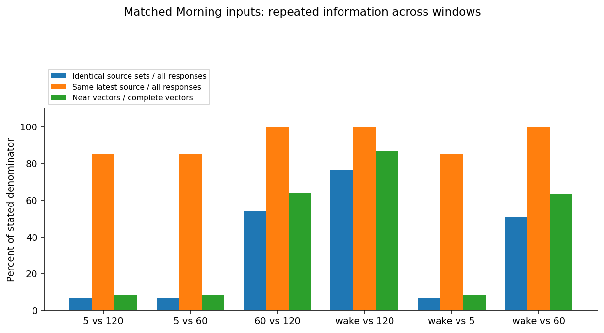
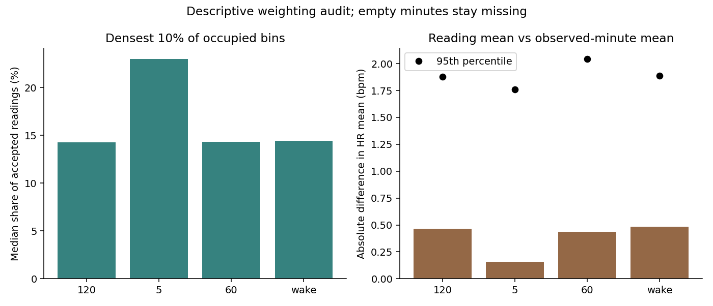
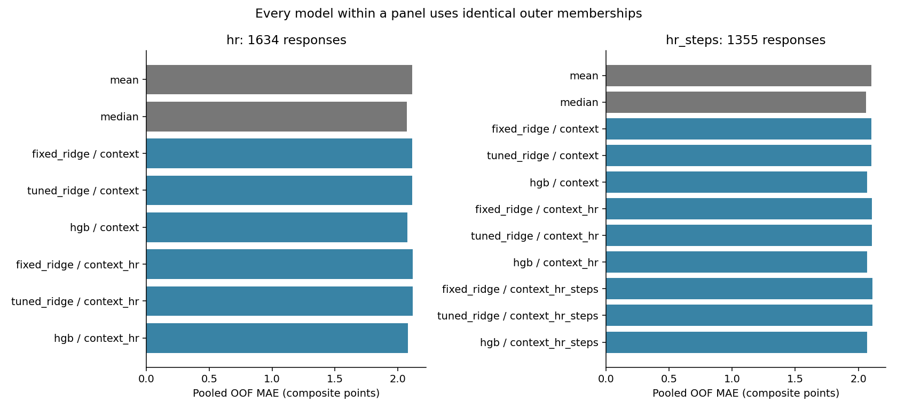
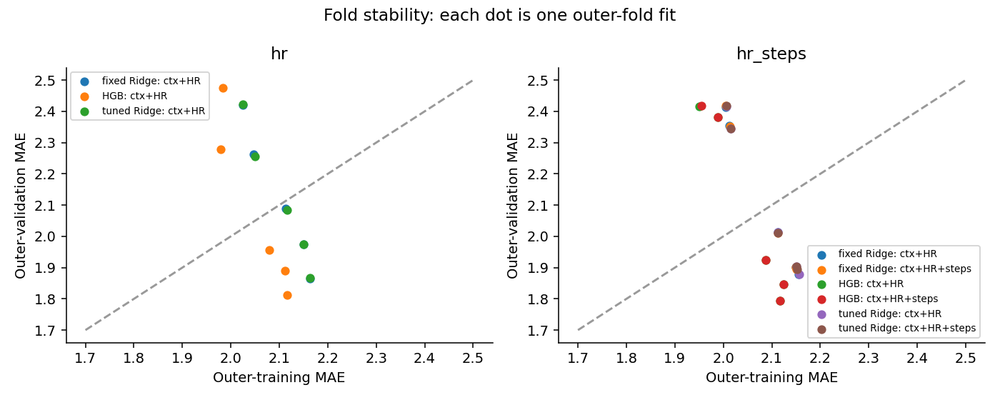

# Notebook 09 — window information and bounded nonlinear benchmark

**Repeated readings explain much of the similarity between Morning window inputs. The new models
still do not establish a useful wearable advantage beyond matching median/context baselines.**
This development-only experiment is exploratory after Notebooks 04–08. Timing remains provisional;
none of these results establish validated real-time prediction or absence of physiological signal.

## What information changes with the window?

The primary Notebook 08 matched Morning cohort contains 227 responses / 86 participants. We also
report its all-four-window intersection (191 / 74), separately for nominal wake and later-minute
sensitivity. Current-survey wake defines a retrospective boundary only. No wake variable enters the
new benchmark. All six pairs are in [window_overlap.md](window_overlap.md).

Wake and 60 minutes have **identical accepted source sets in 116/227 (51.1%)** and identical latest
source readings in **227/227**. Wake and 120 minutes are identical in **173/227 (76.2%)**; fixed
60 and 120 in **123/227 (54.2%)**. Thus different calendar boundaries often add no recorded readings.
Five-minute windows are different more often: only 16/227 source sets match wake, and 193/227 have
any accepted five-minute reading; 191/227 have all four features. The latest reading agrees whenever
both contain readings. Shared/latest agreement is not proof of acquisition timing.

| window_a | window_b | responses | complete_vectors | identical_sets | identical_latest_identity | near_identical_vector | shared_median | only_a_median | only_b_median |
| --- | --- | --- | --- | --- | --- | --- | --- | --- | --- |
| fixed_5 | fixed_120 | 227 | 191 | 16 | 193 | 16 | 191 | 0 | 1414 |
| fixed_5 | fixed_60 | 227 | 191 | 16 | 193 | 16 | 191 | 0 | 1098 |
| fixed_60 | fixed_120 | 227 | 227 | 123 | 227 | 145 | 1239 | 0 | 0 |
| wake | fixed_120 | 227 | 227 | 173 | 227 | 197 | 1443 | 0 | 0 |
| wake | fixed_5 | 227 | 191 | 16 | 193 | 16 | 191 | 1301 | 0 |
| wake | fixed_60 | 227 | 227 | 116 | 227 | 143 | 1188 | 0 | 0 |

Reading identity uses source-content hash plus original row, within verified participant. Conflicting
and rejected groups stay excluded under unchanged rules; repeated equal HR at different times stays
separate. Source equality and feature equality are different questions. Numerical vector identity uses
absolute 1e-10; descriptive near identity uses ≤1 bpm for mean/SD/latest and ≤.1 bpm/min for slope.
These are fixed descriptive tolerances, not clinical or eligibility thresholds. Near wake/60 vectors
occur in 143/227 (63.0%). Denominators for vector comparisons require four finite features on both
sides; no missing feature is replaced by zero. Only-a/only-b are signed window-specific additions;
medians of zero can coexist with substantial differences in a minority of responses.

Wake-versus-60 feature differences (wake minus fixed):

| feature | responses | mean_signed_difference | median_absolute_difference | q95_absolute_difference | pearson | spearman |
| --- | --- | --- | --- | --- | --- | --- |
| mean | 227 | -0.0474 | 0.0000 | 6.6088 | 0.9729 | 0.9711 |
| sd | 227 | 0.4902 | 0.0000 | 3.9676 | 0.8874 | 0.8859 |
| latest | 227 | 0.0000 | 0.0000 | 0.0000 | 1.0000 | 1.0000 |
| slope | 227 | -0.0403 | 0.0000 | 0.4429 | 0.9895 | 0.8549 |

Mean HR correlation is .973; latest is exactly identical. Some differences remain meaningful in
size: the 95th percentile absolute mean difference is 6.61 bpm. Repeated inputs help explain the
near-identical Notebook 08 predictions but cannot alone explain all weak results. All pairs, both
cohorts and both wake scenarios are retained in [feature_differences.md](feature_differences.md).

## Sampling density changes the weighting

Each observed HR reading contributes equally to the existing mean. A densely sampled minute can
therefore outweigh a sparsely sampled minute. The descriptive alternative averages each **observed**
one-minute mean equally, with bins anchored to that window's start; a partial final bin counts as
one observed bin. Empty bins stay missing. Neither mean establishes continuous coverage, and this
alternative is **not used in the benchmark**. Bin anchoring can differ across wake/fixed windows.

| window | count_median_median | count_cv_median | dense_decile_reading_share_median | dense_decile_mean_contribution_bpm_median | absolute_weighting_difference_median | absolute_weighting_difference_q95 |
| --- | --- | --- | --- | --- | --- | --- |
| fixed_120 | 40.0000 | 0.2090 | 0.1426 | 12.4920 | 0.4638 | 1.8780 |
| fixed_5 | 40.0000 | 0.1234 | 0.2297 | 21.4574 | 0.1570 | 1.7580 |
| fixed_60 | 40.0000 | 0.2050 | 0.1433 | 12.4070 | 0.4368 | 2.0418 |
| wake | 40.0000 | 0.2114 | 0.1444 | 12.7452 | 0.4838 | 1.8894 |

The densest ceil(10% of occupied bins) contribute a median 14.4% of wake readings and about 14.3%
of 60-minute readings. Their contribution in bpm is their sum divided by *all* window readings, not
their own mean. Short windows have coarse bin counts (one bin can exceed 10% of occupied bins).
For wake, median absolute difference between weighting methods is .484 bpm (95th percentile 1.889);
for 60 minutes it is .437 bpm (95th percentile 2.042). Count dispersion and quantiles, including
empty five-minute views, are in [density_summary.md](density_summary.md). Occupancy and observation
counts describe support, not representative measurement throughout the interval.

## Does the implemented pipeline work on traceable inputs?

The deterministic trace uses two distinct participants from each original fold (10 responses,
80 window/scenario views). It checks **320 feature values against 18,153 original accepted HR rows**
from ten development sources, with zero mismatches. It independently checks EMA UTC/buffer arithmetic,
participant/fold mapping provenance, source hashes and row numbers, Boolean window boundaries,
raw timestamps/values, duplicate/conflict handling, saved slice lineage and scalar feature arithmetic.
Absent source columns are verified as absent/null, not invented raw values. Only aggregates appear
here; private trace rows remain ignored. This bounded check does not prove the exporter's timestamp
semantics or rule out every possible implementation defect.

A **synthetic-only** positive control injects a known linear relationship into generated HR and
three survey items for 300 responses / 30 synthetic participants. Readings before the left boundary
and exactly at cutoff are decoys. Production clock parsing, HR acceptance/window summaries, shuffled
one-to-one outcome linkage and the actual model-fitting function recover the relationship across
five held-out participant folds: fixed Ridge MAE **.00774**, fixed synthetic HGB MAE **.26608**, versus
median **3.6**. The positive control validates numerical plumbing for this constructed relationship;
it supplies no evidence of real physiological validity or expected real-world effect size.

## Matched nested benchmark

The fixed specification precedes these calculations. Five frozen participant folds form outer
validation; three GroupKFold splits inside each training cohort select by mean inner-fold MAE.
Each scaler/encoder is fitted inside its training split. Ridge grid is .1/1/10/100. HGB uses absolute
error, learning rate .05, minimum leaf 20, L2=1, no early stopping; only depth 1/2 and iterations
50/150 vary. Context is actual-start time sin/cos and survey category. Wearables are the existing
four HR summaries, plus supported steps only on the separate secondary cohort. No quality variables,
missingness, imputation, answers or IDs enter X. Fixed Ridge alpha=1 is independently reproduced.
The 60-minute window is a fixed benchmark, not an optimal or universally recall-aligned interval.
HGB differs from Ridge in loss, regularization and function class, so differences do not isolate
nonlinearity. See the [frozen specification](../../window_benchmark_specification.md).

Primary HR cohort: **1,634 responses / 118 participants** of the 3,706 development responses.
Secondary HR+supported-steps cohort: **1,355 / 113**. Every secondary comparator is refitted on those
same rows. Do not interpret error differences between cohorts as incremental activity gains.
All five outer folds are feasible. [Composition](composition.md) includes retained/excluded survey
representation and score distributions; [fold counts](fold_counts.md) reports exact memberships.
Morning asks since waking; Midday and Endday refer to the last prompt. No missing prompt or waking
boundary is inferred from previous completed surveys or first sensor readings.

| block | model | responses | participants | mae | rmse | participant_mae | prediction_sd |
| --- | --- | --- | --- | --- | --- | --- | --- |
| hr | mean | 1634 | 118 | 2.1146 | 2.5663 | 2.2159 | 0.0424 |
| hr | median | 1634 | 118 | 2.0710 | 2.5814 | 2.1709 | 0.0000 |
| hr | fixed_ridge__context | 1634 | 118 | 2.1132 | 2.5676 | 2.2173 | 0.1260 |
| hr | tuned_ridge__context | 1634 | 118 | 2.1137 | 2.5673 | 2.2158 | 0.0934 |
| hr | hgb__context | 1634 | 118 | 2.0741 | 2.5884 | 2.1767 | 0.1713 |
| hr | fixed_ridge__context_hr | 1634 | 118 | 2.1196 | 2.5744 | 2.2257 | 0.2111 |
| hr | tuned_ridge__context_hr | 1634 | 118 | 2.1187 | 2.5728 | 2.2226 | 0.1774 |
| hr | hgb__context_hr | 1634 | 118 | 2.0814 | 2.6133 | 2.1858 | 0.2858 |
| hr_steps | mean | 1355 | 113 | 2.1016 | 2.5448 | 2.2054 | 0.0368 |
| hr_steps | median | 1355 | 113 | 2.0613 | 2.5564 | 2.1707 | 0.0000 |
| hr_steps | fixed_ridge__context | 1355 | 113 | 2.1028 | 2.5478 | 2.2120 | 0.1232 |
| hr_steps | tuned_ridge__context | 1355 | 113 | 2.1030 | 2.5478 | 2.2093 | 0.0932 |
| hr_steps | hgb__context | 1355 | 113 | 2.0699 | 2.5642 | 2.1728 | 0.1761 |
| hr_steps | fixed_ridge__context_hr | 1355 | 113 | 2.1085 | 2.5541 | 2.2212 | 0.2379 |
| hr_steps | tuned_ridge__context_hr | 1355 | 113 | 2.1077 | 2.5530 | 2.2168 | 0.2067 |
| hr_steps | hgb__context_hr | 1355 | 113 | 2.0690 | 2.5797 | 2.1904 | 0.2159 |
| hr_steps | fixed_ridge__context_hr_steps | 1355 | 113 | 2.1117 | 2.5574 | 2.2239 | 0.2501 |
| hr_steps | tuned_ridge__context_hr_steps | 1355 | 113 | 2.1105 | 2.5561 | 2.2193 | 0.2207 |
| hr_steps | hgb__context_hr_steps | 1355 | 113 | 2.0698 | 2.5813 | 2.1909 | 0.2218 |

Primary HGB context+HR minus median MAE: **+.01038 points, conditional 95% interval
[−.01600,+.03918]**; versus HGB context: **+.00732 [−.01986,+.03622]**. HGB is lower than fixed
Ridge context+HR by .03826 points, but its paired interval [−.08996,+.01785] includes zero. This does
not demonstrate HR-specific gain; the median dummy remains lower in point-estimate MAE.
Secondary HGB context+HR+steps MAE is **2.06983**, versus median **2.06125** and HGB context **2.06985**.
Adding steps to HGB context+HR changes MAE by **+.00078 [−.00392,+.00588]**. No convincing incremental
activity benefit is established. [All 52 paired contrasts](paired_intervals.md) include matching mean,
median, same-family context, fixed Ridge, and same-family HR for the steps addition.

## Training fit, variation and fold stability

Primary HGB context+HR training MAE is **2.05435**, versus OOF **2.08138**. It produces varying
predictions (pooled SD .286), so it has not simply collapsed to the constant median; flexibility has
not established an OOF wearable benefit. Fixed Ridge context+HR training/OOF MAE is 2.09938/2.11963.
Training pooled metrics count repeated outer-training memberships (each response four times), not
independent new observations. All fold/category MAE, RMSE, equal-participant MAE and prediction SD
are in [metrics.md](metrics.md); selected settings, fold losses, ranges and distinct prediction counts
are in [selected_settings.md](selected_settings.md).

All ten primary tuned Ridge fits select alpha=100; secondary settings vary across folds. Most HGB
fits choose depth 1 / 50 iterations, with some depth 2 or longer fits. [Setting stability](setting_stability.md)
shows every selection. All **600 inner learned fits and 75 outer learned fits** complete; the 20
outer dummy predictions use matching training means/medians. No outer-fit warnings are recorded.
The verification replays split/transform checks and HGB outer predictions and independently solves
Ridge, recomputes metrics and paired intervals. **13,311 fixed-reference prediction values** match
Notebook 05 to numerical tolerance.

Intervals use 2,000 paired participant-cluster resamples of fixed OOF predictions. They retain all
responses for a sampled participant and do not treat overlapping windows as independent. They are
conditional on this repeated exploratory workflow, not refitting/tuning uncertainty, external
validation, multiplicity-adjusted significance or proof of equivalence. Nested tuning protects outer
folds from this search; it does not erase prior development inspection. No winning window or model
is declared and the search is not expanded.

## What this resolves and what still needs evidence

**Verified here:** many Morning windows reuse exactly the same source information; linked sampled
features match original readings; synthetic injected signal is recovered; the bounded nonlinear
family varies predictions but does not establish gain beyond matched baselines.
**Provisional:** HR acceptance, observation-weighted summaries, activity-counter interpretation,
minute wake sensitivity and timestamp use remain assumptions, not validated device standards.
**Unknown:** whether timestamps locate acquisition or receipt, whether batching changes apparent
cadence, and which quality annotations distinguish trustworthy physiological measurements.

**Recommendation:** do not automatically expand model/window searches. Seek provider documentation
and instrumented timing/quality evidence first, then specify an independent development comparison
of measurement-valid intervals and recall boundaries. If an observed-minute weighting comparison is
pursued, freeze it as a separate experiment; this descriptive audit does not authorize substituting
features or claim that weighting correction will help. Final-test evaluation remains sealed.

Provider-question draft (not sent):

1. Does Garmin `ts` timestamp acquisition, interval start/end or server receipt? Can batch delivery
   change timestamp spacing, ordering or duplicate values? Is device acquisition time retained?
2. Can notification/scheduled/delivered/displayed prompt logs be supplied with timezone and clock
   resolution, so Midday/Endday's previous-prompt recall boundary can be observed?
3. Which per-reading device, wear/contact, motion, confidence and beat-quality flags exist? How are
   invalid or stale HR readings exported, and what intervals do step-counter updates represent?

## Artifacts

Source notebook: `notebooks/09_window_information_and_nonlinear_benchmark.ipynb`.
Private immutable bundle: `private/window_benchmark/runs/22397f30f1439325`. It contains ignored `window_pairs.parquet`,
`window_density.parquet`, `source_trace.parquet`, `membership.parquet`, `training_predictions.parquet`,
`out_of_fold_predictions.parquet` and training audits. Aggregate tables/figures are in this directory.
Raw sources, earlier bundles, corrected boundaries and assignments/folds are preserved. No HRV,
Garmin stress, imputation, binary targets, final-test evaluation, commit, push or provider messages.
